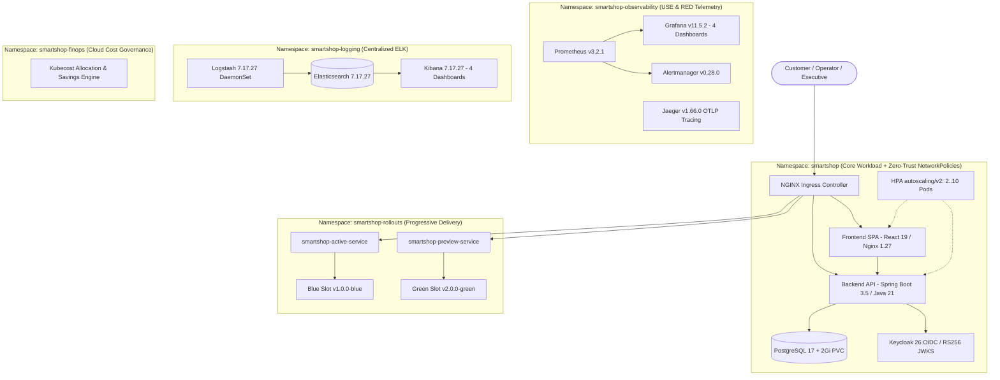

# SmartShop Cloud-Native Platform

Enterprise Cloud-Native E-Commerce Platform engineered with **React 19 + TypeScript 5.8**, **Java 21 LTS + Spring Boot 3.5 (Hexagonal Architecture)**, **PostgreSQL 17**, **Keycloak 26 OIDC/RBAC**, and orchestrated on **Kubernetes (Minikube v1.37)** with **Zero-Trust NetworkPolicies**, **Prometheus + Grafana + Alertmanager + Jaeger Observability (USE & RED)**, **ELK Centralized Logging**, **Kubecost FinOps**, **Horizontal Pod Autoscaling (HPA v2)**, and **Blue-Green Progressive Delivery**.

---

## 1. Platform Architecture Overview



---

## 2. Repository Structure

| Directory                   | Responsibility                                                                                                                                  |
| --------------------------- | ----------------------------------------------------------------------------------------------------------------------------------------------- |
| `frontend/`                 | React 19.1, Vite 7.3.7, TypeScript 5.8, Tailwind CSS 4, Zustand 5, Framer Motion SPA                                                            |
| `backend/`                  | Java 21 LTS, Spring Boot 3.5.0 Hexagonal Architecture (`domain`, `application`, `infrastructure`)                                               |
| `database/`                 | PostgreSQL 17 Docker Compose & Flyway SQL migrations (`V1`, `V2`)                                                                               |
| `authentication/`           | Keycloak 26 OIDC Realm configuration (`smartshop-realm.json`) & Docker Compose                                                                  |
| `k8s/`                      | Kubernetes manifests: `namespaces/`, `configmaps/`, `secrets/`, `pvc/`, `deployments/`, `services/`, `ingress/`, `network-policies/`, `hpa/`    |
| `observability/`            | `prometheus/`, `grafana/` (4 dashboards: Infrastructure USE, Kubernetes, Application RED, Business KPIs), `alertmanager/`, `jaeger/`            |
| `logging/elk/`              | `elasticsearch-deployment.yaml`, `logstash-deployment.yaml`, `kibana-deployment.yaml`, and 4 Kibana NDJSON dashboards                           |
| `cost-management/kubecost/` | Kubecost FinOps engine, allocation APIs (`namespace`, `deployment`, `workload`), and right-sizing recommendations                               |
| `rollout/`                  | `blue-green/` manifests (`Blue` v1.0.0-blue & `Green` v2.0.0-green) and `argo-rollouts/` Canary/Blue-Green/Shadow specs                         |
| `scripts/`                  | 6 automation scripts (`start-all.sh`, `stop-all.sh`, `restart-all.sh`, `status.sh`, `validate.sh`, `benchmark.sh`)                              |
| `docs/`                     | Complete Technical Documentation (`8` guides), Business & FinOps Documentation (`6` guides), and Empirical Verification Evidence (`01` to `18`) |

---

## 3. Quick Start & Operational Scripts

All operational scripts are POSIX-compliant and executable from Linux/macOS/Git Bash:

```bash
# 1. Start and reconcile the entire Kubernetes platform
bash scripts/start-all.sh

# 2. Inspect real-time cluster status across all 5 namespaces
bash scripts/status.sh

# 3. Run the 17-point automated end-to-end validation suite
bash scripts/validate.sh

# 4. Execute synthetic HTTP performance & zero-error benchmarks
bash scripts/benchmark.sh

# 5. Perform zero-downtime rolling restarts
bash scripts/restart-all.sh

# 6. Safely stop or scale down workloads
bash scripts/stop-all.sh --dry-run
```

---

## 4. Technical & Business Documentation Index

### Technical Architecture Documentation (`docs/`)

- [Architecture & Roadmap](docs/architecture/roadmap-and-architecture.md)
- [Kubernetes Architecture (`docs/kubernetes.md`)](docs/kubernetes.md)
- [Keycloak OIDC & RBAC (`docs/keycloak.md`)](docs/keycloak.md)
- [Prometheus Monitoring (`docs/prometheus.md`)](docs/prometheus.md)
- [Grafana Dashboards (`docs/grafana.md`)](docs/grafana.md)
- [ELK Centralized Logging (`docs/elk.md`)](docs/elk.md)
- [Kubecost FinOps (`docs/kubecost.md`)](docs/kubecost.md)
- [Horizontal Pod Autoscaler (`docs/hpa.md`)](docs/hpa.md)
- [Blue-Green Progressive Delivery (`docs/blue-green.md`)](docs/blue-green.md)

### Business & Executive Value Documentation (`docs/`)

- [Executive Summary (`docs/executive-summary.md`)](docs/executive-summary.md)
- [Business Model & Unit Economics (`docs/business-model.md`)](docs/business-model.md)
- [Observability Business Value (`docs/observability-value.md`)](docs/observability-value.md)
- [Kubecost FinOps ROI (`docs/kubecost-value.md`)](docs/kubecost-value.md)
- [Zero-Trust Security Value (`docs/security-value.md`)](docs/security-value.md)
- [Progressive Deployment Value (`docs/deployment-value.md`)](docs/deployment-value.md)

### Empirical Verification & Evidence (`docs/evidence/`)

- Tasks `01` through `18` verification reports in [`docs/evidence/`](docs/evidence/), including live HPA load test snapshots ([`docs/evidence/hpa/`](docs/evidence/hpa/)) and Blue-Green zero-downtime switch/rollback logs ([`docs/evidence/blue-green/`](docs/evidence/blue-green/)).

Enterprise Cloud-Native E-Commerce Platform engineered with **React 19 + TypeScript 5.8**, **Java 21 LTS + Spring Boot 3.5 (Hexagonal Architecture)**, **PostgreSQL 17**, **Keycloak 26 OIDC/RBAC**, and orchestrated on **Kubernetes (Minikube v1.37)** with **Zero-Trust NetworkPolicies**, **Prometheus + Grafana + Alertmanager + Jaeger Observability (USE & RED)**, **ELK Centralized Logging**, **Kubecost FinOps**, **Horizontal Pod Autoscaling (HPA v2)**, and **Blue-Green Progressive Delivery**.

---

## 1. Platform Architecture Overview


---

## 2. Repository Structure

| Directory | Responsibility |
|---|---|
| `frontend/` | React 19.1, Vite 7.3.7, TypeScript 5.8, Tailwind CSS 4, Zustand 5, Framer Motion SPA |
| `backend/` | Java 21 LTS, Spring Boot 3.5.0 Hexagonal Architecture (`domain`, `application`, `infrastructure`) |
| `database/` | PostgreSQL 17 Docker Compose & Flyway SQL migrations (`V1`, `V2`) |
| `authentication/` | Keycloak 26 OIDC Realm configuration (`smartshop-realm.json`) & Docker Compose |
| `k8s/` | Kubernetes manifests: `namespaces/`, `configmaps/`, `secrets/`, `pvc/`, `deployments/`, `services/`, `ingress/`, `network-policies/`, `hpa/` |
| `observability/` | `prometheus/`, `grafana/` (4 dashboards: Infrastructure USE, Kubernetes, Application RED, Business KPIs), `alertmanager/`, `jaeger/` |
| `logging/elk/` | `elasticsearch-deployment.yaml`, `logstash-deployment.yaml`, `kibana-deployment.yaml`, and 4 Kibana NDJSON dashboards |
| `cost-management/kubecost/` | Kubecost FinOps engine, allocation APIs (`namespace`, `deployment`, `workload`), and right-sizing recommendations |
| `rollout/` | `blue-green/` manifests (`Blue` v1.0.0-blue & `Green` v2.0.0-green) and `argo-rollouts/` Canary/Blue-Green/Shadow specs |
| `scripts/` | 6 automation scripts (`start-all.sh`, `stop-all.sh`, `restart-all.sh`, `status.sh`, `validate.sh`, `benchmark.sh`) |
| `docs/` | Complete Technical Documentation (`8` guides), Business & FinOps Documentation (`6` guides), and Empirical Verification Evidence (`01` to `18`) |

---

## 3. Quick Start & Operational Scripts

All operational scripts are POSIX-compliant and executable from Linux/macOS/Git Bash:

```bash
# 1. Start and reconcile the entire Kubernetes platform
bash scripts/start-all.sh

# 2. Inspect real-time cluster status across all 5 namespaces
bash scripts/status.sh

# 3. Run the 17-point automated end-to-end validation suite
bash scripts/validate.sh

# 4. Execute synthetic HTTP performance & zero-error benchmarks
bash scripts/benchmark.sh

# 5. Perform zero-downtime rolling restarts
bash scripts/restart-all.sh

# 6. Safely stop or scale down workloads
bash scripts/stop-all.sh --dry-run
```

---

## 4. Technical & Business Documentation Index

### Technical Architecture Documentation (`docs/`)
- [Architecture & Roadmap](docs/architecture/roadmap-and-architecture.md)
- [Kubernetes Architecture (`docs/kubernetes.md`)](docs/kubernetes.md)
- [Keycloak OIDC & RBAC (`docs/keycloak.md`)](docs/keycloak.md)
- [Prometheus Monitoring (`docs/prometheus.md`)](docs/prometheus.md)
- [Grafana Dashboards (`docs/grafana.md`)](docs/grafana.md)
- [ELK Centralized Logging (`docs/elk.md`)](docs/elk.md)
- [Kubecost FinOps (`docs/kubecost.md`)](docs/kubecost.md)
- [Horizontal Pod Autoscaler (`docs/hpa.md`)](docs/hpa.md)
- [Blue-Green Progressive Delivery (`docs/blue-green.md`)](docs/blue-green.md)

### Business & Executive Value Documentation (`docs/`)
- [Executive Summary (`docs/executive-summary.md`)](docs/executive-summary.md)
- [Business Model & Unit Economics (`docs/business-model.md`)](docs/business-model.md)
- [Observability Business Value (`docs/observability-value.md`)](docs/observability-value.md)
- [Kubecost FinOps ROI (`docs/kubecost-value.md`)](docs/kubecost-value.md)
- [Zero-Trust Security Value (`docs/security-value.md`)](docs/security-value.md)
- [Progressive Deployment Value (`docs/deployment-value.md`)](docs/deployment-value.md)

### Empirical Verification & Evidence (`docs/evidence/`)
- Tasks `01` through `18` verification reports in [`docs/evidence/`](docs/evidence/), including live HPA load test snapshots ([`docs/evidence/hpa/`](docs/evidence/hpa/)) and Blue-Green zero-downtime switch/rollback logs ([`docs/evidence/blue-green/`](docs/evidence/blue-green/)).
