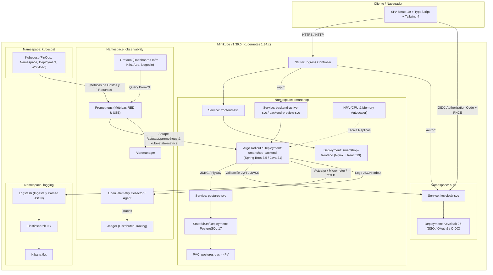
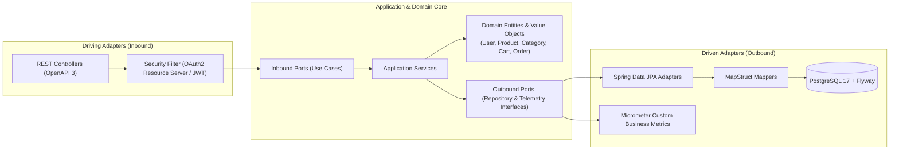
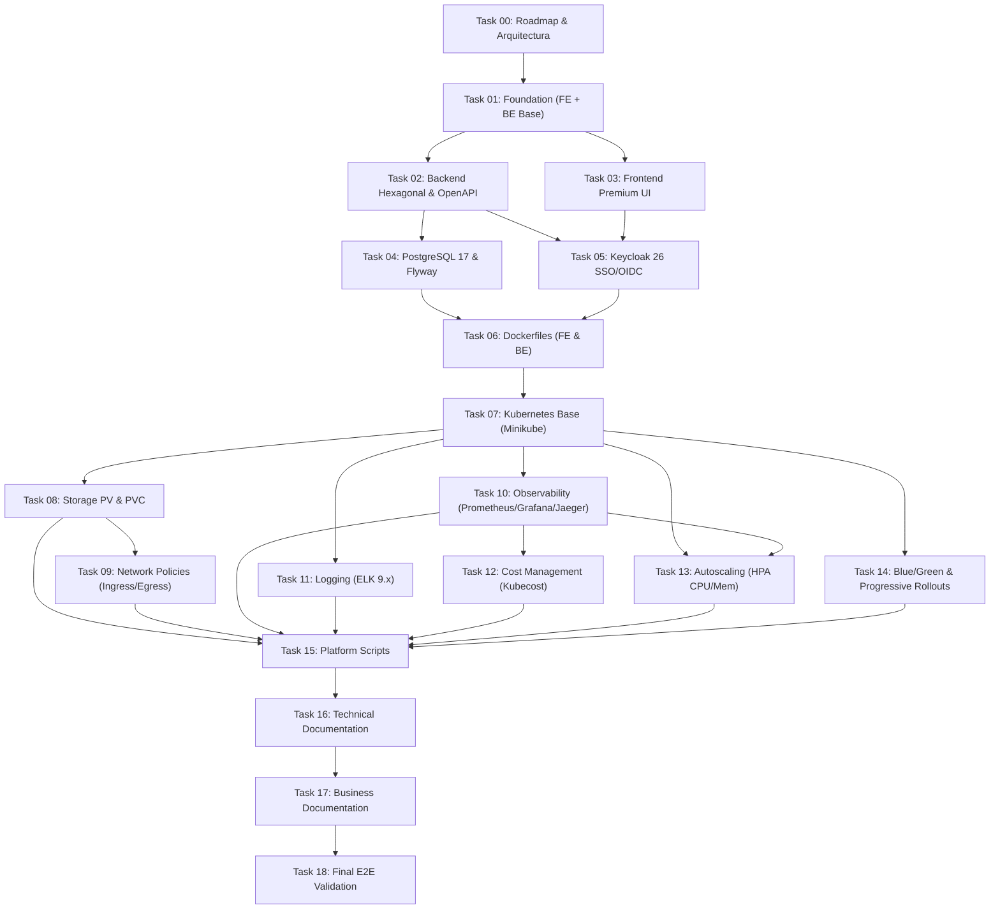

# SmartShop Cloud-Native Platform — Arquitectura Detallada y Roadmap Maestro

## 1. Arquitectura Detallada

### 1.1 Visión General de la Plataforma Cloud-Native
**SmartShop Cloud-Native Platform** es una plataforma de comercio electrónico empresarial diseñada bajo principios Cloud-Native y desplegada sobre **Kubernetes (Minikube v1.39.0 / K8s v1.34.x)**. Integra arquitectura hexagonal en el backend, diseño atómico y basado en funcionalidades en el frontend, identidad centralizada (SSO/OIDC), observabilidad integral (modelos RED y USE), logging centralizado, gestión de costos (FinOps), autoescalado horizontal y estrategias avanzadas de despliegue progresivo sin tiempo de inactividad (Zero-Downtime).

---

### 1.2 Arquitectura del Backend (Spring Boot 3.5.x + Java 21 LTS — Hexagonal Architecture)
El backend aplica **Arquitectura Hexagonal (Ports & Adapters)**, principios **SOLID** y **Clean Code**, garantizando que el dominio de negocio (`User`, `Product`, `Category`, `Cart`, `Order`) sea independiente de frameworks, bases de datos y detalles de transporte.

**Capas del paquete `com.smartshop.platform`:**
- `domain.model`: Entidades puras de dominio (`User`, `Product`, `Category`, `Cart`, `CartItem`, `Order`, `OrderItem`), enums (`Role`, `OrderStatus`) y excepciones de dominio.
- `domain.port.in`: Casos de uso (Ports de entrada).
- `domain.port.out`: Interfaces de persistencia y publicación de métricas de negocio (Ports de salida).
- `application.service`: Implementación de casos de uso orquestando reglas de negocio y métricas de negocio (`smartshop_active_users`, `smartshop_products_visited_total`, `smartshop_carts_created_total`, `smartshop_orders_completed_total`, `smartshop_conversion_rate`).
- `infrastructure.adapter.in.web`: Controladores REST documentados con SpringDoc OpenAPI (`/swagger-ui.html`, `/v3/api-docs`), DTOs de entrada/salida y `GlobalExceptionHandler`.
- `infrastructure.adapter.out.persistence`: Entidades JPA, repositorios Spring Data, mappers MapStruct y migraciones versionadas en `db/migration/` con **Flyway**.
- `infrastructure.config`: Configuración de Seguridad OAuth2/OIDC (roles `ADMIN`, `MANAGER`, `CUSTOMER`), CORS, OpenAPI, Actuator Health Probes (`/actuator/health/liveness`, `/actuator/health/readiness`) y Feature Flags.

---

### 1.3 Arquitectura del Frontend (React 19 + TypeScript 5 + Vite 7 — Feature-Based + Atomic Design)
Inspirado en **Vercel, Stripe y Linear**, el frontend combina una estética minimalista de alto contraste, soporte nativo de **Dark Mode**, micro-interacciones fluidas con **Framer Motion** y alto rendimiento (**Lighthouse > 90**).

- **Estructura Híbrida (Feature-Based + Atomic Design)**:
  - `src/components/atoms/`: Botones, badges, inputs, iconos, indicadores de estado, toggles de tema.
  - `src/components/molecules/`: Tarjetas de producto, barra de búsqueda, selectores de categoría, métricas KPI, banners de versión (Blue/Green/Canary indicator).
  - `src/components/organisms/`: Navbar con estado SSO y carrito, Hero interactivo, tabla de administración, drawer de carrito, panel de Feature Flags.
  - `src/components/templates/`: `MainLayout`, `DashboardLayout`, `AuthLayout`.
  - `src/features/`:
    - `landing/`: Landing page estilo Vercel/Stripe con animaciones Framer Motion y métricas en vivo.
    - `auth/`: Integración OIDC/Keycloak (`ADMIN`, `MANAGER`, `CUSTOMER`), login/logout y protección de rutas.
    - `catalog/`: Catálogo de productos, filtros por categoría, búsqueda instantánea y telemetría de visita de productos.
    - `cart/`: Gestión de estado reactiva con **Zustand 5**, persistencia y cálculo de impuestos/envío.
    - `dashboard/`: Panel ejecutivo de ventas, órdenes, inventario y estado de despliegue.

---

### 1.4 Seguridad, Red y Persistencia en Kubernetes
1. **Identidad (Keycloak 26)**:
   - Realm `smartshop` preconfigurado con clientes para Frontend (public client + PKCE) y Backend (bearer-only / resource server).
   - Roles RBAC: `ADMIN` (gestión total y configuración), `MANAGER` (gestión de catálogo e inventario), `CUSTOMER` (compras, carrito y órdenes).
2. **Almacenamiento Persistente (PV & PVC)**:
   - `PersistentVolume` y `PersistentVolumeClaim` (`postgres-pvc`) garantizando supervivencia de datos ante reinicios o recreación de pods de PostgreSQL 17.
3. **Políticas de Red (Zero-Trust NetworkPolicies)**:
   - Política Default-Deny por namespace y reglas explícitas de **Ingress** y **Egress**:
     - `frontend` solo recibe tráfico del `ingress-nginx` y solo se comunica hacia `backend`.
     - `backend` solo recibe tráfico de `ingress-nginx`, `frontend` y `prometheus`, y solo tiene egress hacia `postgres`, `keycloak`, `logstash`/`otel` y DNS (`kube-system` puerto 53).
     - `postgres` solo acepta conexiones en `5432` provenientes de `backend`.

---

### 1.5 Observabilidad (RED & USE), Logging (ELK 9.x) y Costos (Kubecost)
- **Modelo USE (Utilization, Saturation, Errors)**: CPU, RAM, Disco y Red de nodos, cluster (`kube-apiserver`, `etcd`) y contenedores vía `node-exporter`, `kube-state-metrics` y `cAdvisor`.
- **Modelo RED (Rate, Errors, Duration)**: Throughput (RPS), tasa de error HTTP (`4xx`/`5xx`) y latencias (`p50`, `p95`, `p99`) del backend y endpoints críticos.
- **Métricas de Negocio**: Usuarios activos, productos visitados, carritos activos, órdenes/compras completadas y tasa de conversión en tiempo real visualizadas en Grafana.
- **Trazabilidad Distribuida**: OpenTelemetry enviando spans hacia **Jaeger**.
- **Logging Centralizado (ELK 9.x)**: Logs estructurados JSON capturados desde aplicaciones y Kubernetes hacia **Logstash**, indexados en **Elasticsearch 9.x** y visualizados en **Kibana 9.x**.
- **FinOps (Kubecost)**: Visibilidad de costos por Namespace, Deployment y Workload, con recomendaciones de dimensionamiento (right-sizing).

---

### 1.6 Estrategias de Despliegue (Zero-Downtime & Progressive Delivery)
De acuerdo con `deployment-requirements.md`, `definition-of-done.md` y `14-blue-green.md`, la plataforma soportará y documentará las 6 estrategias de despliegue utilizando **Kubernetes nativo y Argo Rollouts**:
1. **Blue/Green Deployment**: Servicios `active` (Blue) y `preview` (Green), cambio instantáneo de selector/Argo Rollout promotion y rollback inmediato con cero downtime comprobado.
2. **Canary Deployment**: División gradual de tráfico (ej. 10% -> 50% -> 100%) con validación de métricas de error/latencia.
3. **Rolling Deployment**: Actualización progresiva con `maxSurge` y `maxUnavailable` garantizando disponibilidad continua.
4. **Recreate Deployment**: Terminación completa de la versión previa antes de iniciar la nueva (útil para cambios incompatibles de esquema).
5. **Shadow (Dark Launch / Traffic Mirroring)**: Duplicación asíncrona de tráfico real hacia una versión sombra sin impactar la respuesta al usuario.
6. **Feature Flags**: Activación/desactivación dinámica de funcionalidades en tiempo de ejecución desde el backend/frontend sin redesplegar.

---

## 2. Roadmap Completo del Proyecto

| ID | Tarea | Objetivo Principal | Entregables Clave | Criterios de Éxito (DoD) |
| :--- | :--- | :--- | :--- | :--- |
| **Task 00** | `00-roadmap` | Análisis arquitectónico, roadmap, dependencias y riesgos | `docs/architecture/roadmap-and-architecture.md` | Arquitectura definida, Roadmap generado, Dependencias identificadas, Riesgos documentados |
| **Task 01** | `01-foundation` | Crear la base del proyecto (Frontend + Backend + Linters) | `frontend/` (React 19, Vite 7, TS), `backend/` (Java 21, Spring Boot 3.5), `.gitignore`, ESLint, Prettier | Frontend compila, Backend compila, Proyecto ejecutable |
| **Task 02** | `02-backend` | Implementar backend e-commerce con Arquitectura Hexagonal | Dominio (`User`, `Product`, `Category`, `Cart`, `Order`), casos de uso, REST API, OpenAPI, Actuator, Tests unitarios | CRUD funcional, OpenAPI funcional, Health Check funcional, Tests exitosos |
| **Task 03** | `03-frontend` | Crear interfaz premium (Vercel/Stripe/Linear style) | Landing, Login, Dashboard, Productos, Carrito con Tailwind 4, Shadcn UI, Framer Motion, Zustand, TanStack Query | Responsive, Dark Mode, Animaciones fluidas, Lighthouse > 90 |
| **Task 04** | `04-postgresql` | Implementar PostgreSQL 17 y migraciones con Flyway | Esquema SQL en `db/migration/`, configuración JPA/PostgreSQL, datos semilla (seed data) | Base conectada, Migraciones ejecutadas, Datos persistentes |
| **Task 05** | `05-authentication` | Integrar Keycloak 26 (SSO, OAuth2, OIDC) | Realm export `smartshop-realm.json`, seguridad JWT en Backend, flujo OIDC en Frontend, roles `ADMIN`, `MANAGER`, `CUSTOMER` | Login funcional, Logout funcional, Roles funcionales, APIs protegidas |
| **Task 06** | `06-docker` | Dockerizar aplicaciones con builds multi-stage optimizados | `frontend/Dockerfile` (Node 24 -> Nginx non-root), `backend/Dockerfile` (JDK 21 -> JRE 21 non-root), `.dockerignore`, `docker-compose.yml` | Build exitoso, Containers saludables (`HEALTHCHECK`) |
| **Task 07** | `07-kubernetes-base` | Desplegar plataforma base en Minikube | Manifiestos en `k8s/` (Namespaces, ConfigMaps, Secrets, Deployments, Services, Ingress) | Pods Running, Services funcionales, Ingress funcional |
| **Task 08** | `08-storage-pvc` | Implementar almacenamiento persistente para PostgreSQL | `k8s/pvc/postgres-pv.yaml`, `k8s/pvc/postgres-pvc.yaml`, montaje en PostgreSQL | Datos persisten, Reinicio exitoso de pod, PVC en estado `Bound` |
| **Task 09** | `09-network-policies` | Implementar seguridad de red Zero-Trust en Kubernetes | `k8s/network-policies/` (Ingress & Egress policies para frontend, backend, database, auth, observability) | Tráfico permitido funciona, Tráfico no permitido bloqueado, Evidencia documentada |
| **Task 10** | `10-observability` | Implementar observabilidad (Prometheus, Grafana, Alertmanager, OTel, Jaeger) | `observability/` (Prometheus, Alertmanager, Grafana dashboards RED/USE/Negocio, Jaeger tracing) | Prometheus operativo, Grafana operativo, Jaeger operativo, Dashboards visibles, Alertas funcionando |
| **Task 11** | `11-elk` | Implementar stack de logging centralizado ELK 9.x | `logging/elk/` (Elasticsearch, Logstash, Kibana + recolector de logs de K8s y App) | Logs capturados, Logs indexados, Kibana funcional |
| **Task 12** | `12-kubecost` | Implementar monitoreo de costos FinOps con Kubecost | `cost-management/kubecost/` (Despliegue y configuración por Namespace, Deployment, Workload) | Dashboard operativo, Costos visibles, Recomendaciones visibles |
| **Task 13** | `13-hpa` | Implementar Horizontal Pod Autoscaler (CPU y Memoria) | `k8s/hpa/backend-hpa.yaml`, `frontend-hpa.yaml`, generador de carga y captura de evidencia | Escala arriba bajo carga, Escala abajo en reposo, Evidencia capturada |
| **Task 14** | `14-blue-green` | Implementar estrategias de despliegue (Blue/Green, Canary, Rolling, Recreate, Shadow, Feature Flags) | `rollout/` (Manifiestos Blue/Green, Argo Rollouts Canary/Blue-Green, Rolling, Recreate, Shadow Ingress, Feature Flags) | Blue funciona, Green funciona, Switch funciona, Rollback funciona, Cero downtime comprobado + todas las estrategias documentadas y reversibles |
| **Task 15** | `15-platform-scripts` | Crear suite de scripts operativos de plataforma | `scripts/` (`start-all.sh`, `stop-all.sh`, `restart-all.sh`, `status.sh`, `validate.sh`, `benchmark.sh`) | Scripts ejecutables, Scripts documentados, Scripts funcionales |
| **Task 16** | `16-technical-docs` | Generar documentación técnica estandarizada por tecnología | `docs/` (`kubernetes.md`, `keycloak.md`, `prometheus.md`, `grafana.md`, `elk.md`, `kubecost.md`, `hpa.md`, `blue-green.md`) | Todos los documentos creados y actualizados con las 8 secciones obligatorias |
| **Task 17** | `17-business-docs` | Generar documentación ejecutiva y de valor de negocio | `docs/` (`executive-summary.md`, `business-model.md`, `observability-value.md`, `kubecost-value.md`, `security-value.md`, `deployment-value.md`) | Todos los documentos creados, Beneficios explicados, Justificación empresarial documentada |
| **Task 18** | `18-final-validation` | Validación integral end-to-end y verificación de todos los DoD | Ejecución de `validate.sh`, pruebas de extremo a extremo y reporte de evidencia final | 100% de componentes y DoD verificados en verde |

---

## 3. Dependencias entre Tareas

### Matriz de Dependencias Clave
- **Task 01 (`01-foundation`)** depende de **Task 00 (`00-roadmap`)**: define la estructura base sobre la que se construyen todos los módulos.
- **Task 02 (`02-backend`)** y **Task 03 (`03-frontend`)** dependen de **Task 01**: requieren el esqueleto de compilación de Spring Boot 3.5 y React 19 + Vite 7 respectivamente.
- **Task 04 (`04-postgresql`)** depende de **Task 02**: requiere el modelo de entidades del backend para versionar las migraciones Flyway (`V1__init_schema.sql`, `V2__seed_data.sql`).
- **Task 05 (`05-authentication`)** depende de **Task 02 y Task 03**: protege los endpoints REST del backend con OAuth2 Resource Server y conecta el flujo OIDC en la interfaz React.
- **Task 06 (`06-docker`)** depende de **Task 02, 03, 04 y 05**: empaqueta las aplicaciones completas y listas para producción en imágenes inmutables.
- **Task 07 (`07-kubernetes-base`)** depende de **Task 06**: despliega las imágenes construidas en Minikube junto con ConfigMaps, Secrets, Services e Ingress.
- **Task 08 (`08-storage-pvc`)** y **Task 09 (`09-network-policies`)** dependen de **Task 07**: aseguran la persistencia de datos en Kubernetes y el aislamiento de red entre pods.
- **Tasks 10, 11, 12, 13, 14** dependen de **Task 07 (y Task 08)**: instrumentan métricas, logs, costos, autoescalado y despliegues sin caída sobre el clúster activo. **Task 12 (Kubecost)** y **Task 13 (HPA)** se apoyan además en las métricas recolectadas en **Task 10** y `metrics-server`.
- **Task 15 (`15-platform-scripts`)** orquesta los componentes creados entre las Tasks 07 y 14.
- **Task 16 (`16-technical-docs`)** y **Task 17 (`17-business-docs`)** consolidan todos los parámetros reales, arquitecturas y evidencias obtenidas hasta Task 15.
- **Task 18 (`18-final-validation`)** depende del 100% de las tareas anteriores.

---

## 4. Orden Óptimo de Implementación

El orden estrictamente secuencial de **`00` a `18`** está diseñado para minimizar retrabajo y validar cada capa antes de introducir complejidad de infraestructura:

1. **Fase 0 — Diseño y Planeación (`Task 00`)**: Definir arquitectura, contratos, puertos, métricas de negocio y estrategia Git.
2. **Fase 1 — Construcción de Aplicación Core (`Task 01` → `Task 02` → `Task 03` → `Task 04` → `Task 05`)**:
   - Primero levantar el esqueleto compilable (`Task 01`).
   - Implementar la lógica de dominio hexagonal, OpenAPI y health checks (`Task 02`) con pruebas unitarias rápidas.
   - Construir la experiencia de usuario premium en React 19 con soporte de temas y animaciones (`Task 03`).
   - Integrar persistencia relacional real con PostgreSQL 17 y Flyway (`Task 04`).
   - Cerrar el ciclo funcional con autenticación federada SSO en Keycloak 26 y control de acceso por roles (`Task 05`).
3. **Fase 2 — Contenerización y Fundación Kubernetes (`Task 06` → `Task 07` → `Task 08` → `Task 09`)**:
   - Empaquetar en contenedores ligeros y saludables (`Task 06`).
   - Desplegar en Minikube con Ingress (`Task 07`), adjuntar volúmenes persistentes PV/PVC (`Task 08`) y blindar el tráfico con NetworkPolicies (`Task 09`).
4. **Fase 3 — Observabilidad, Logging y FinOps (`Task 10` → `Task 11` → `Task 12`)**:
   - Activar Prometheus, Grafana, Alertmanager, OpenTelemetry y Jaeger (`Task 10`).
   - Desplegar el pipeline ELK 9.x (`Task 11`).
   - Integrar Kubecost reutilizando métricas de Prometheus (`Task 12`).
5. **Fase 4 — Escalabilidad y Entrega Progresiva (`Task 13` → `Task 14`)**:
   - Configurar HPA por CPU/Memoria y ejecutar pruebas de estrés (`Task 13`).
   - Implementar Blue/Green, Canary, Rolling, Recreate, Shadow y Feature Flags con Argo Rollouts e Ingress (`Task 14`).
6. **Fase 5 — Automatización, Documentación y Certificación (`Task 15` → `Task 16` → `Task 17` → `Task 18`)**:
   - Automatizar operación con scripts (`Task 15`), documentar a nivel técnico (`Task 16`) y ejecutivo (`Task 17`), y ejecutar la auditoría final (`Task 18`).

---

## 5. Riesgos Técnicos y Estrategia de Mitigación

| # | Riesgo Técnico | Severidad | Impacto | Estrategia de Mitigación |
| :- | :--- | :---: | :--- | :--- |
| **R1** | **Saturación de RAM y CPU en Minikube** al ejecutar simultáneamente App, PostgreSQL, Keycloak, Prometheus, Grafana, Jaeger, ELK 9.x y Kubecost. | Alta | `OOMKilled` en pods de Elasticsearch o Keycloak, o pods en estado `Pending` por falta de CPU/Memoria. | Configurar `requests` ajustados y `limits` controlados por contenedor; ejecutar Elasticsearch en modo `single-node` con heap JVM optimizado (`-Xms512m -Xmx512m`); reutilizar la instancia de Prometheus existente para Kubecost. |
| **R2** | **Bloqueo involuntario de tráfico por NetworkPolicies (`Task 09`)** hacia DNS (`kube-dns`/`CoreDNS`), Keycloak, Prometheus o Logstash. | Alta | Fallos de resolución de nombres internos, scraping caído en Prometheus o fallo de validación JWKS. | Incluir explícitamente reglas de Egress hacia `kube-system` (UDP/TCP 53) y permitir Ingress en `/actuator/prometheus` desde el namespace `observability`. Validar conectividad antes y después de aplicar cada política. |
| **R3** | **Desincronización de Issuer URI en Keycloak OIDC (`Task 05` / `Task 07`)** entre acceso desde el navegador (Ingress) y comunicación interna pod-a-pod. | Media | Error `Invalid Issuer` en Spring Security al validar tokens JWT emitidos por Keycloak. | Configurar `issuer-uri` / `jwk-set-uri` en Spring Boot separando la URL pública de autorización del endpoint interno de descubrimiento JWKS (`KC_HOSTNAME` consistente vía Ingress). |
| **R4** | **Ausencia de JDK / Maven global en el host Windows** durante la compilación local del Backend (`Task 01` / `Task 02`). | Media | Comandos `java` o `mvn` no reconocidos en la terminal local. | Proveer **Maven Wrapper (`mvnw` / `mvnw.cmd`)** dentro de `backend/` y configurar una instalación local/portable de **OpenJDK 21 LTS** para garantizar compilación y ejecución determinista tanto en host como en Docker. |
| **R5** | **Latencia en recolección de métricas de `metrics-server` para HPA (`Task 13`)**. | Baja | HPA muestra `<unknown>/70%` si `metrics-server` no está habilitado o los pods no declaran `resources.requests`. | Habilitar el addon `metrics-server` en Minikube y definir obligatoriamente `resources.requests.cpu` y `resources.requests.memory` en todos los Deployments/Rollouts. |
| **R6** | **Compatibilidad de estilos y rendimiento con React 19 + Tailwind 4 (`Task 03`)**. | Baja | Degradación del puntaje Lighthouse (< 90) por bundles pesados o animaciones costosas. | Utilizar code-splitting (`React.lazy`), animaciones aceleradas por GPU (`transform`/`opacity` en Framer Motion) y compresión Gzip/Brotli en Nginx. |

---

## 6. Estimación de Commits Atómicos

Siguiendo estrictamente `.antigravity/context/git-workflow.md` y `.antigravity/context/coding-standards.md` (**Atomic Commits Only**, en inglés y sin abreviaturas oscuras), se estima un total de **38 a 45 commits atómicos** distribuidos por tarea:

### Fase 0: Roadmap (`Task 00`)
1. `docs(architecture): add comprehensive platform architecture and master roadmap`

### Fase 1: Foundation, Backend, Frontend, Database & Auth (`Tasks 01 - 05`)
2. `chore(foundation): configure root gitignore and editor formatting rules`
3. `feat(frontend): initialize react 19 vite 7 typescript foundation with eslint and prettier`
4. `feat(backend): initialize spring boot 3.5 java 21 hexagonal project foundation`
5. `feat(backend): implement domain entities and ports for user product category cart and order`
6. `feat(backend): implement application use cases and business metrics instrumentation`
7. `feat(backend): add rest controllers openapi documentation and actuator health probes`
8. `test(backend): add unit and integration tests for hexagonal domain and rest adapters`
9. `feat(frontend): configure tailwind 4 design system dark mode and atomic ui components`
10. `feat(frontend): create vercel and stripe inspired landing and catalog pages with framer motion`
11. `feat(frontend): implement interactive shopping cart and executive dashboard views`
12. `feat(database): add flyway migrations and postgresql 17 persistence configuration`
13. `feat(auth): add keycloak 26 realm configuration with admin manager and customer roles`
14. `feat(auth): integrate oauth2 oidc security in backend resource server and frontend client`

### Fase 2: Docker & Kubernetes Core (`Tasks 06 - 09`)
15. `feat(docker): add multi-stage dockerfiles for frontend and backend with healthchecks`
16. `feat(kubernetes): add namespaces configmaps and secrets manifests for smartshop`
17. `feat(kubernetes): add deployments services and nginx ingress manifests`
18. `feat(storage): add persistent volume and persistent volume claim for postgresql`
19. `feat(security): add ingress and egress network policies with verification evidence`

### Fase 3: Observability, Logging & FinOps (`Tasks 10 - 12`)
20. `feat(observability): deploy prometheus alertmanager and opentelemetry collector manifests`
21. `feat(observability): deploy grafana with red use and business metrics dashboards`
22. `feat(observability): deploy jaeger distributed tracing integration`
23. `feat(logging): deploy elasticsearch logstash and kibana 9 stack manifests`
24. `feat(logging): configure application and kubernetes log ingestion pipelines`
25. `feat(costs): deploy kubecost cost monitoring and workload allocation manifests`

### Fase 4: Autoscaling & Progressive Delivery (`Tasks 13 - 14`)
26. `feat(hpa): configure horizontal pod autoscaler for cpu and memory targets`
27. `docs(hpa): capture load testing and scale up scale down evidence`
28. `feat(rollout): implement blue green deployment services and traffic switch manifests`
29. `feat(rollout): add argo rollouts canary rolling recreate shadow and feature flags configurations`
30. `docs(rollout): add zero downtime verification and rollback evidence for all strategies`

### Fase 5: Scripts, Documentation & Final Validation (`Tasks 15 - 18`)
31. `feat(scripts): add operational lifecycle scripts start stop restart and status`
32. `feat(scripts): add automated platform validation and benchmark scripts`
33. `docs(technical): add kubernetes keycloak হpa and blue green technical guides`
34. `docs(technical): add prometheus grafana elk and kubecost technical guides`
35. `docs(business): add executive summary and business model documentation`
36. `docs(business): add observability kubecost security and deployment business value guides`
37. `chore(validation): execute end-to-end validation and finalize definition of done report`
