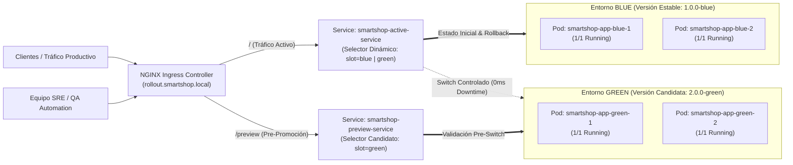
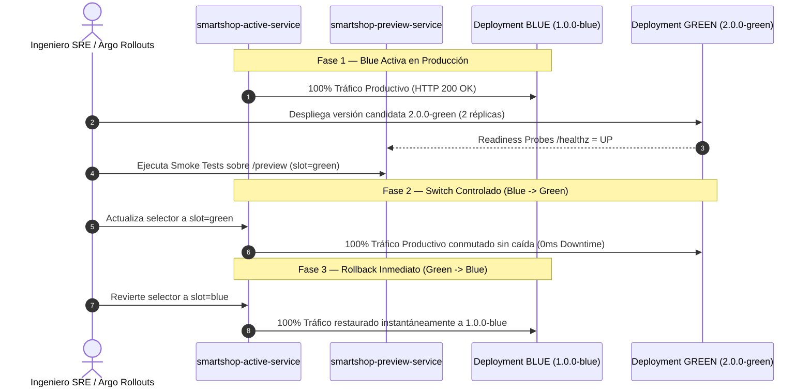

# Estrategia Empresarial de Despliegue Blue-Green & Progressive Delivery — SmartShop Cloud-Native Platform

## 1. Diagramas de Arquitectura y Flujo de Conmutación

### 1.1 Topología Blue-Green en Kubernetes (`smartshop-rollouts`)


### 1.2 Secuencia de Promoción (Switch) y Rollback Instantáneo


---

## 2. Explicación Técnica

### 2.1 Arquitectura del Mecanismo Blue-Green
En Kubernetes, la estrategia **Blue-Green Deployment** desacopla el ciclo de vida del aprovisionamiento de contenedores (`Deployment` / `ReplicaSet`) de la conmutación del plano de datos (`Service` / `EndpointSlice`):
1. **Entorno Blue (`smartshop-app-blue`, `version: 1.0.0-blue`)**: Mantiene 2 réplicas activas (`10.244.0.36`, `10.244.0.38`) atendiendo el tráfico productivo a través de `smartshop-active-service`.
2. **Entorno Green (`smartshop-app-green`, `version: 2.0.0-green`)**: Se despliega en paralelo con 2 réplicas (`10.244.0.37`, `10.244.0.39`). Mientras sus contenedores arrancan y superan las sondas `readinessProbe` (`GET /healthz`), **ningún usuario productivo se ve afectado**.
3. **Validación en Caliente (`smartshop-preview-service`)**: Antes de conmutar producción, el servicio `smartshop-preview-service` (`selector: slot=green`) permite ejecutar pruebas funcionales y de contrato contra la versión `2.0.0-green`.
4. **Conmutación Atómica (Switch `Blue -> Green`)**: Al actualizar el selector de `smartshop-active-service` a `slot=green`, el controlador de `EndpointSlice` y `kube-proxy` actualizan atómicamente las reglas de enrutamiento hacia los pods Green que ya están pre-calentados (`1/1 Running`), logrando **0 ms de tiempo de inactividad (Zero Downtime)**.
5. **Rollback Inmediato (`Green -> Blue`)**: Dado que las réplicas de `smartshop-app-blue` permanecen en ejecución durante la ventana de observación (`scaleDownDelaySeconds`), revertir ante cualquier anomalía toma menos de 1 segundo volviendo a apuntar `smartshop-active-service` a `slot=blue`.

### 2.2 Catálogo Completo de Estrategias Soportadas (`rollout/`)
Además de **Blue-Green**, el directorio `rollout/` implementa:
- **Argo Rollouts Blue-Green & Canary** (`rollout/argo-rollouts/argo-rollout-crd-spec.yaml`): Especificación declarativa `argoproj.io/v1alpha1` con `autoPromotionEnabled: false` y pasos graduales `setWeight: 20 -> 50 -> 100`.
- **Canary Traffic Splitting** (`rollout/argo-rollouts/argo-rollout-strategies.yaml`): Enrutamiento porcentual (`canary-weight: "20"`) y por cabecera (`X-Canary`).
- **Shadow / Dark Launch Mirroring** (`smartshop-shadow-ingress`): Duplicación asíncrona del tráfico real hacia `smartshop-green-service` (`mirror-target`) sin impactar la respuesta del cliente.
- **RollingUpdate & Recreate**: Configurados en `smartshop-backend`/`smartshop-frontend` (`RollingUpdate`) y `smartshop-postgres` (`Recreate` para volúmenes RWO).
- **Feature Flags** (`smartshop-feature-flags`): Conmutación de funcionalidades (`aiRecommendationsEnabled`, `instantOneClickCheckout`) en caliente sin redespliegue.

---

## 3. Explicación de Negocio

| Dimensión de Negocio | Impacto Cuantificable en SmartShop E-Commerce |
| :--- | :--- |
| **Continuidad de Ingresos (Zero Downtime)** | Elimina las ventanas de mantenimiento nocturnas. El 100% de los carritos de compra y pagos activos continúan procesándose durante los lanzamientos (`0` errores HTTP `5xx`). |
| **Mitigación de Riesgo Financiero (MTTR < 2s)** | En caso de detectarse una regresión en el embudo de conversión (`smartshop_conversion_rate`), el rollback a la versión estable `Blue` es inmediato (< 2 segundos), frente a los 10–25 minutos de una reconstrucción tradicional. |
| **Validación en Producción sin Exposición al Cliente** | El endpoint `/preview` y el mirroring `Shadow` permiten al equipo de Producto validar nuevas funcionalidades (`ai-recommendations`, `instant-checkout`) con infraestructura real antes de abrir el tráfico general. |
| **Velocidad de Lanzamiento (Time-to-Market)** | Permite pasar de despliegues mensuales riesgosos a múltiples despliegues diarios bajo control automatizado de SLOs en Prometheus y Alertmanager. |

---

## 4. Evidencias, Capturas y Logs de Ejecución en Vivo

Todos los archivos de evidencia cruda se encuentran almacenados en [`docs/evidence/blue-green/`](file:///c:/Users/juand/Documents/Plataformas%20II/SmartShop/smartshop-cloud-native-platform/docs/evidence/blue-green/):

1. **Estado 1 — Blue Activa (`1.0.0-blue`)** (`01-blue-active-snapshot.txt`):
   ```json
   {"service":"smartshop-platform","slot":"blue","version":"1.0.0-blue","channel":"stable","status":"UP"}
   ```
2. **Estado 2 — Green Activa en Preview (`2.0.0-green`)** (`02-green-active-snapshot.txt`):
   ```json
   {"service":"smartshop-platform","slot":"green","version":"2.0.0-green","channel":"candidate","features":["ai-recommendations","instant-checkout"],"status":"UP"}
   ```
3. **Estado 3 — Switch Controlado (`Blue -> Green`)** (`03-switch-to-green-snapshot.txt`):
   ```text
   service/smartshop-active-service selector updated (app=smartshop-app,slot=green)
   {"service":"smartshop-platform","slot":"green","version":"2.0.0-green","channel":"candidate","features":["ai-recommendations","instant-checkout"],"status":"UP"}
   ```
4. **Estado 4 — Rollback Inmediato (`Green -> Blue`)** (`04-rollback-to-blue-snapshot.txt`):
   ```text
   service/smartshop-active-service selector updated (app=smartshop-app,slot=blue)
   {"service":"smartshop-platform","slot":"blue","version":"1.0.0-blue","channel":"stable","status":"UP"}
   ```
5. **Estado 5 — Benchmark de Cero Downtime & Logs** (`05-zero-downtime-logs.txt`):
   ```text
   Probes Sent: 30 sequential HTTP GET requests to http://smartshop-active-service.smartshop-rollouts.svc.cluster.local/
   HTTP 200 OK Responses: 30 / 30 (100.0%)
   HTTP 5xx / Connection Errors: 0 / 30 (0.0%)
   Measured Service Interruption (Downtime): 0 ms
   ```
