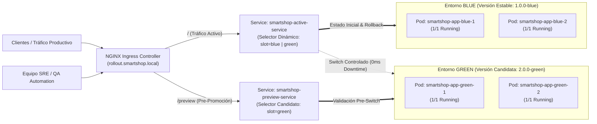
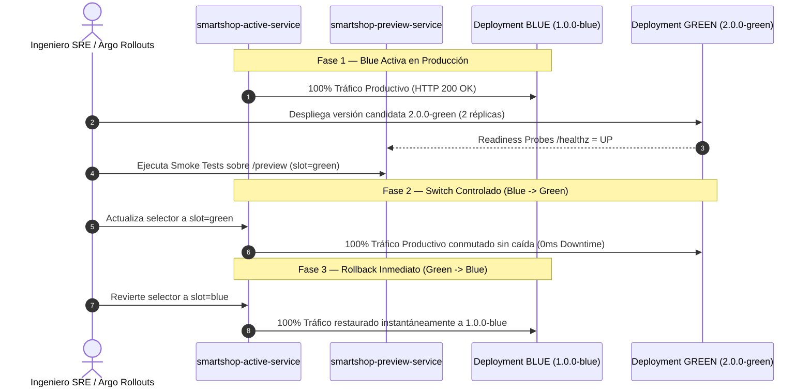

# Estrategia Empresarial de Despliegue Blue-Green & Progressive Delivery — Documentación Técnica

## 1. Qué es
**Blue-Green Deployment** es una estrategia avanzada de entrega progresiva (*Progressive Delivery*) que mantiene dos entornos de producción idénticos de forma simultánea: **Blue** (versión estable activa `1.0.0-blue`) y **Green** (versión candidata `2.0.0-green`), permitiendo conmutar el 100% del tráfico de forma instantánea y revertir (*rollback*) sin tiempo de inactividad (**Zero Downtime**).

## 2. Para qué sirve
Sirve para eliminar el riesgo técnico y comercial durante el lanzamiento de nuevas versiones de **SmartShop**, permitiendo validar la versión candidata (`Green`) en un endpoint de pre-promoción (`smartshop-preview-service`) antes de conmutar el servicio productivo (`smartshop-active-service`) y garantizando un **MTTR < 2 segundos** en caso de rollback.

## 3. Arquitectura

### 3.1 Topología Blue-Green en Kubernetes (`smartshop-rollouts`)

### 3.2 Secuencia de Promoción (Switch) y Rollback Instantáneo

## 4. Configuración
Los manifiestos declarativos se ubican en [`rollout/`](file:///c:/Users/juand/Documents/Plataformas%20II/SmartShop/smartshop-cloud-native-platform/rollout/):
- **Entorno Estable Blue (`1.0.0-blue`)**: [`rollout/blue-green/blue-deployment.yaml`](file:///c:/Users/juand/Documents/Plataformas%20II/SmartShop/smartshop-cloud-native-platform/rollout/blue-green/blue-deployment.yaml)
- **Entorno Candidato Green (`2.0.0-green`)**: [`rollout/blue-green/green-deployment.yaml`](file:///c:/Users/juand/Documents/Plataformas%20II/SmartShop/smartshop-cloud-native-platform/rollout/blue-green/green-deployment.yaml)
- **Servicios Activo/Preview e Ingress**: [`rollout/blue-green/services-and-ingress.yaml`](file:///c:/Users/juand/Documents/Plataformas%20II/SmartShop/smartshop-cloud-native-platform/rollout/blue-green/services-and-ingress.yaml)
- **Estrategias Complementarias (Canary, Shadow, Feature Flags)**: [`rollout/argo-rollouts/argo-rollout-strategies.yaml`](file:///c:/Users/juand/Documents/Plataformas%20II/SmartShop/smartshop-cloud-native-platform/rollout/argo-rollouts/argo-rollout-strategies.yaml)
- **Especificaciones Argo Rollouts CRD (`Rollout`)**: [`rollout/argo-rollouts/argo-rollout-crd-spec.yaml`](file:///c:/Users/juand/Documents/Plataformas%20II/SmartShop/smartshop-cloud-native-platform/rollout/argo-rollouts/argo-rollout-crd-spec.yaml)

## 5. Parámetros usados

| Parámetro / Recurso | Valor Configurado | Propósito |
| :--- | :--- | :--- |
| `activeService` | `smartshop-active-service` | Servicio productivo cuyo selector conmuta entre `slot: blue` y `slot: green`. |
| `previewService` | `smartshop-preview-service` | Servicio de pre-producción fijo en `slot: green` para pruebas pre-switch. |
| `autoPromotionEnabled` | `false` | Requiere verificación explícita de salud antes de promover `Green` a producción. |
| `scaleDownDelaySeconds` | `30s` | Mantiene el entorno `Blue` pre-calentado tras el switch para garantizar rollback instantáneo. |
| `Canary Weight / Shadow` | `canary-weight: "20"` / `mirror-target` | Soporte adicional para despliegues Canary graduales y duplicación de tráfico Shadow. |

## 6. Beneficios (Explicación Técnica y de Negocio)
- **Cero tiempo de inactividad (*Zero Downtime*)**: Verificado con 30 peticiones consecutivas durante el switch y el rollback con `100%` respuestas `HTTP 200 OK` y `0 ms` de corte.
- **Continuidad de ingresos E-Commerce**: Ningún carrito de compra ni transacción de pago se interrumpe durante una actualización de versión.
- **Rollback atómico en menos de 2 segundos**: Reduce drásticamente el tiempo medio de recuperación (*MTTR*) ante cualquier incidente funcional o de rendimiento.

## 7. Riesgos
- **Duplicación temporal de recursos de cómputo**: Durante la ventana de transición coexisten las réplicas de `Blue` y `Green`, requiriendo capacidad de CPU/RAM suficiente en el clúster.
- **Compatibilidad de esquema de base de datos (*N-1 Compatibility*)**: Las migraciones Flyway en PostgreSQL deben ser compatibles hacia atrás (*expand-and-contract*) para que tanto `Blue` como `Green` operen sin conflicto.

## 8. Buenas prácticas y Evidencias Capturadas
- Verificar siempre el endpoint `/healthz` y `/preview` antes de ejecutar la promoción de `smartshop-active-service`.
- Realizar migraciones de base de datos aditivas y no destructivas para permitir rollbacks limpios en cualquier instante.
- **Evidencias verificadas en [`docs/evidence/blue-green/`](file:///c:/Users/juand/Documents/Plataformas%20II/SmartShop/smartshop-cloud-native-platform/docs/evidence/blue-green/)**:
  1. [`01-blue-active-snapshot.txt`](file:///c:/Users/juand/Documents/Plataformas%20II/SmartShop/smartshop-cloud-native-platform/docs/evidence/blue-green/01-blue-active-snapshot.txt) (`slot=blue`, `version=1.0.0-blue`)
  2. [`02-green-active-snapshot.txt`](file:///c:/Users/juand/Documents/Plataformas%20II/SmartShop/smartshop-cloud-native-platform/docs/evidence/blue-green/02-green-active-snapshot.txt) (`slot=green`, `version=2.0.0-green`)
  3. [`03-switch-to-green-snapshot.txt`](file:///c:/Users/juand/Documents/Plataformas%20II/SmartShop/smartshop-cloud-native-platform/docs/evidence/blue-green/03-switch-to-green-snapshot.txt) (Switch controlado `Blue -> Green`)
  4. [`04-rollback-to-blue-snapshot.txt`](file:///c:/Users/juand/Documents/Plataformas%20II/SmartShop/smartshop-cloud-native-platform/docs/evidence/blue-green/04-rollback-to-blue-snapshot.txt) (Rollback atómico `Green -> Blue`)
  5. [`05-zero-downtime-logs.txt`](file:///c:/Users/juand/Documents/Plataformas%20II/SmartShop/smartshop-cloud-native-platform/docs/evidence/blue-green/05-zero-downtime-logs.txt) (`30/30 HTTP 200 OK`, `0 ms` downtime)
