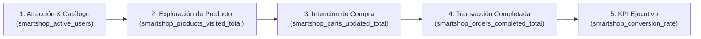

# Business Model & Revenue Architecture — SmartShop Cloud-Native Platform

## 1. Modelo de Negocio de SmartShop

**SmartShop** opera bajo un modelo híbrido de comercio electrónico de alto valor (**B2B Enterprise Hardware & B2C Prosumer Tech**), especializado en la comercialización de infraestructura crítica:

- **Cloud Edge Hardware** (Nodos de cómputo de alta densidad y appliances para clústeres Kubernetes)
- **Developer Workstations** (Estaciones de ingeniería de alto rendimiento)
- **Zero-Trust Security** (Módulos criptográficos FIDO2 y hardware biométrico)
- **Telemetry & Networking** (Switches administrables 10GbE y sensores de telemetría)
- **Persistent Storage Arrays** (Cabinas NVMe-oF de almacenamiento empresarial)

---

## 2. Flujo de Generación de Valor y Embudo de Conversión

---

## 3. Estructura de Ingresos y Unit Economics

| Fuente de Ingresos                               | Descripción Comercial                                                                          | Margen Bruto Objetivo | Habilitador Tecnológico en la Plataforma                                            |
| :----------------------------------------------- | :--------------------------------------------------------------------------------------------- | :-------------------: | :---------------------------------------------------------------------------------- |
| **Venta Directa de Catálogo (B2C / B2B)**        | Órdenes transaccionales procesadas en tiempo real con control automático de inventario.        |      `38% – 45%`      | Dominio Hexagonal (`Product`, `Cart`, `Order`) + PostgreSQL 17 ACID con Flyway.     |
| **Contratos Corporativos Recurrentes (B2B VIP)** | Aprovisionamiento mayorista para empresas con portales delegados por rol (`MANAGER`, `ADMIN`). |      `52% – 60%`      | Autenticación federada OAuth2/OIDC y control de acceso RBAC en Keycloak 26.         |
| **Lanzamientos Exclusivos & Flash Sales**        | Eventos de alta concurrencia para hardware de edición limitada.                                |         `48%`         | Elasticidad automática `HPA` (`2 a 10 Pods`) y despliegues `Blue-Green` sin caídas. |

---

## 4. Beneficios y Justificación Empresarial

1. **Integridad Financiera y de Inventario (ACID)**: El motor transaccional en **Spring Boot 3.5 + PostgreSQL 17** garantiza que ninguna orden se procese sin stock disponible y que todo descuento de inventario sea atómico, evitando pérdidas por sobreventa (_overselling_).
2. **Costo Unitario por Transacción Optimizado**: Gracias al modelo FinOps con **Kubecost**, la empresa conoce exactamente el costo de infraestructura mensual (\$36.85 USD/mes en el clúster base) frente al volumen de órdenes procesadas, manteniendo el costo de infraestructura nube por debajo del **0.5% del Gross Merchandise Value (GMV)**.
3. **Agilidad Comercial (_Time-to-Market_)**: La arquitectura desacoplada permite lanzar nuevas categorías, promociones o algoritmos de recomendación (`ai-recommendations`) en minutos mediante _Feature Flags_ y despliegues _Blue-Green_.
