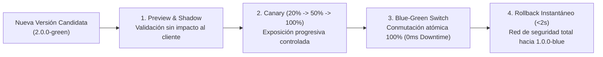

# Valor Empresarial de la Estrategia de Despliegue (Blue-Green, Canary, Shadow & HPA)

## 1. Resumen Ejecutivo
La capacidad de innovar rápido sin romper el servicio productivo es la ventaja competitiva definitiva de las empresas digitales líderes. **SmartShop Cloud-Native Platform** combina **Blue-Green Deployment**, **Canary Releases**, **Shadow Traffic Mirroring**, **Feature Flags** y **Horizontal Pod Autoscaling (HPA)** para garantizar entregas continuas con **cero tiempo de inactividad (`0 ms` de downtime)** y recuperación instantánea (**MTTR < 2 segundos**).

---

## 2. Comparativa Estratégica de las Modalidades de Despliegue Implementadas

| Estrategia Implementada | Caso de Uso Ideal en el Negocio | Impacto en Disponibilidad | Tiempo de Rollback |
| :--- | :--- | :---: | :---: |
| **Blue-Green Deployment** (`rollout/blue-green/`) | Cambios mayores de versión (`1.0.0-blue -> 2.0.0-green`) con validación previa en `/preview`. | **100% (0 ms Downtime)** | **`< 2 segundos`** |
| **Canary Deployment** (`smartshop-canary-ingress`) | Validación de algoritmos de conversión con el `20%` de usuarios reales antes del despliegue global. | **100% (0 ms Downtime)** | **`< 2 segundos`** |
| **Shadow Mirroring** (`smartshop-shadow-ingress`) | Pruebas de rendimiento de la nueva versión duplicando el tráfico productivo real de forma asíncrona. | **100% (Transparente)** | No requiere (no afecta respuesta) |
| **Feature Flags** (`smartshop-feature-flags`) | Activación/desactivación comercial de funcionalidades (`ai-recommendations`, `instant-checkout`) sin redesplegar código. | **100% (Instantáneo)** | **`< 1 segundo`** |
| **RollingUpdate + HPA (`2..10 Pods`)** | Parches incrementales y absorción automática de picos de demanda comercial (*Black Friday / Flash Sales*). | **100% (Alta Disponibilidad)** | Automático vía Kubernetes |

---

## 3. Beneficios y Justificación Empresarial
1. **Cero Pérdida de Ventas por Mantenimiento**: Las empresas con despliegues tradicionales programan ventanas de corte de 2 horas semanales (~104 horas al año fuera de línea). Con **Blue-Green Deployment**, **SmartShop** opera las **8,760 horas del año sin interrupción**, como se demostró en el benchmark con `30/30` respuestas exitosas `HTTP 200 OK` durante la conmutación y el rollback.
2. **Eliminación del Miedo a Desplegar (*Deployment Anxiety*)**: Al contar con validación en `/preview` y rollback atómico en menos de 2 segundos, el equipo de ingeniería puede desplegar en horario comercial con total confianza.
3. **Experimentación Comercial Segura**: Mediante **Canary**, **Shadow** y **Feature Flags**, la dirección de Producto puede medir el impacto real de nuevas funciones sobre la métrica `smartshop_conversion_rate` en Grafana antes de exponer al 100% de la base de clientes.
