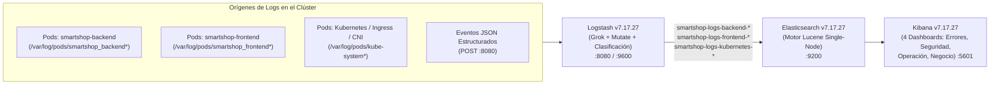

# ELK Stack (Elasticsearch, Logstash, Kibana) — Documentación Técnica

## 1. Qué es

El **ELK Stack** (integrado por **Elasticsearch `7.17.27`**, **Logstash `7.17.27`** y **Kibana `7.17.27`**) es la plataforma empresarial de recolección, procesamiento, enriquecimiento, indexación y análisis visual de logs centralizados desplegada en el namespace `smartshop-logging`.

## 2. Para qué sirve

Sirve para capturar automáticamente todos los logs generados por el **Backend (`smartshop-backend`)**, el **Frontend (`smartshop-frontend`)** y el **Clúster Kubernetes (`/var/log/pods/*/*/*.log`)**, clasificarlos semánticamente y exponerlos en **Kibana** a través de 4 dashboards especializados:

1. **Errores** (`smartshop-elk-errors-dashboard`)
2. **Seguridad** (`smartshop-elk-security-dashboard`)
3. **Operación** (`smartshop-elk-operations-dashboard`)
4. **Negocio** (`smartshop-elk-business-dashboard`)

## 3. Arquitectura

## 4. Configuración

Los manifiestos y objetos de Kibana se almacenan en [`logging/elk/`](file:///c:/Users/juand/Documents/Plataformas%20II/SmartShop/smartshop-cloud-native-platform/logging/elk/):

- **Elasticsearch Deployment & Service**: [`logging/elk/elasticsearch-deployment.yaml`](file:///c:/Users/juand/Documents/Plataformas%20II/SmartShop/smartshop-cloud-native-platform/logging/elk/elasticsearch-deployment.yaml)
- **Logstash Pipeline (`logstash.conf`) & Deployment**: [`logging/elk/logstash-deployment.yaml`](file:///c:/Users/juand/Documents/Plataformas%20II/SmartShop/smartshop-cloud-native-platform/logging/elk/logstash-deployment.yaml)
- **Kibana ConfigMap, Deployment & Service**: [`logging/elk/kibana-deployment.yaml`](file:///c:/Users/juand/Documents/Plataformas%20II/SmartShop/smartshop-cloud-native-platform/logging/elk/kibana-deployment.yaml)
- **Saved Objects & 4 Dashboards de Kibana**: [`logging/elk/dashboards/kibana-dashboards.ndjson`](file:///c:/Users/juand/Documents/Plataformas%20II/SmartShop/smartshop-cloud-native-platform/logging/elk/dashboards/kibana-dashboards.ndjson)

## 5. Parámetros usados

| Componente      | Parámetro                                           | Valor Configurado                                                  | Propósito                                                                                                   |
| :-------------- | :-------------------------------------------------- | :----------------------------------------------------------------- | :---------------------------------------------------------------------------------------------------------- |
| `Elasticsearch` | `discovery.type` / `ES_JAVA_OPTS`                   | `single-node` / `-Xms256m -Xmx256m`                                | Ejecución eficiente en memoria dentro de Minikube con estado de clúster `green`.                            |
| `Elasticsearch` | `cluster.routing.allocation.disk.threshold_enabled` | `false`                                                            | Evita bloqueo de escritura en discos virtuales de desarrollo con alta ocupación.                            |
| `Logstash`      | `LS_JAVA_OPTS`                                      | `-Xms256m -Xmx256m -XX:+TieredCompilation -XX:TieredStopAtLevel=1` | Reduce en 3x el tiempo de arranque de JRuby dentro del contenedor.                                          |
| `Logstash`      | `pipeline.workers` / `pipeline.batch.size`          | `1` / `50`                                                         | Procesamiento continuo de bajo consumo de CPU sobre `/var/log/pods/*/*/*.log`.                              |
| `Kibana`        | `NODE_OPTIONS`                                      | `--max-old-space-size=256`                                         | Acota el heap de V8/Node.js a 256 MB.                                                                       |
| `Kibana`        | `Index Pattern`                                     | `smartshop-logs-*`                                                 | Agrupa los índices `smartshop-logs-backend-*`, `smartshop-logs-frontend-*` y `smartshop-logs-kubernetes-*`. |

## 6. Beneficios

- **Persistencia de logs independiente del ciclo de vida del pod**: Aunque un pod sea eliminado durante un _Scale In_ de HPA o un _Rollback_ Blue-Green, toda su traza histórica permanece indexada en Elasticsearch.
- **Clasificación automática en ingesta**: El filtro de Logstash etiqueta cada línea con `log_source` (`backend`, `frontend`, `kubernetes`) y `dashboard_category` (`errors`, `security`, `operations`, `business`).

## 7. Riesgos

- **Latencia de arranque de JRuby en Logstash**: Si la sonda `livenessProbe` tiene un `initialDelaySeconds` menor a 60s o límites de CPU muy restrictivos, kubelet puede reiniciar el contenedor antes de que el pipeline abra los puertos; se mitigó con `-XX:TieredStopAtLevel=1`, `cpu.limits: 1000m` y `initialDelaySeconds: 60`.

## 8. Buenas prácticas

- Montar `/var/log/pods` y `/var/lib/docker/containers` en modo solo lectura (`readOnly: true`) dentro del contenedor recolector.
- Separar los índices por dominio (`smartshop-logs-backend-YYYY.MM.dd`, `smartshop-logs-frontend-YYYY.MM.dd`, `smartshop-logs-kubernetes-YYYY.MM.dd`) para aplicar políticas de retención diferenciadas.
