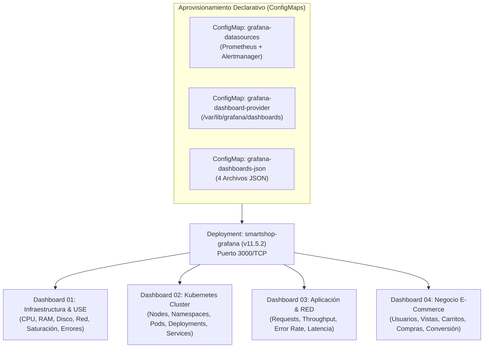

# Grafana Enterprise Visualization — Documentación Técnica

## 1. Qué es
**Grafana (`v11.5.2`)** es la plataforma líder de visualización analítica y observabilidad operativa. En **SmartShop Cloud-Native Platform**, se despliega en el namespace `smartshop-observability` con aprovisionamiento declarativo (*Configuration as Code*) tanto de fuentes de datos (`Prometheus` y `Alertmanager`) como de **4 Dashboards separados por categoría**.

## 2. Para qué sirve
Sirve para proporcionar visibilidad unificada y en tiempo real (refresco cada `10s`) a los equipos de SRE, Ingeniería de Plataforma y Dirección de Negocio a través de 4 tableros especializados:
1. **Infraestructura & Modelo USE** (`smartshop-infra-use`)
2. **Clúster Kubernetes & Workloads** (`smartshop-k8s-cluster`)
3. **Aplicación & Modelo RED** (`smartshop-app-red`)
4. **Negocio & KPIs E-Commerce** (`smartshop-business-kpis`)

## 3. Arquitectura

## 4. Configuración
Los artefactos de Grafana se encuentran en [`observability/grafana/`](file:///c:/Users/juand/Documents/Plataformas%20II/SmartShop/smartshop-cloud-native-platform/observability/grafana/):
- **Deployment, Service y Provisioning ConfigMaps**: [`observability/grafana/grafana-deployment.yaml`](file:///c:/Users/juand/Documents/Plataformas%20II/SmartShop/smartshop-cloud-native-platform/observability/grafana/grafana-deployment.yaml)
- **ConfigMap de los 4 Dashboards JSON**: [`observability/grafana/grafana-dashboards-configmap.yaml`](file:///c:/Users/juand/Documents/Plataformas%20II/SmartShop/smartshop-cloud-native-platform/observability/grafana/grafana-dashboards-configmap.yaml)
- **Archivos fuente de los 4 Dashboards**:
  - [`01-infrastructure-use-dashboard.json`](file:///c:/Users/juand/Documents/Plataformas%20II/SmartShop/smartshop-cloud-native-platform/observability/grafana/dashboards/01-infrastructure-use-dashboard.json)
  - [`02-kubernetes-cluster-dashboard.json`](file:///c:/Users/juand/Documents/Plataformas%20II/SmartShop/smartshop-cloud-native-platform/observability/grafana/dashboards/02-kubernetes-cluster-dashboard.json)
  - [`03-application-red-dashboard.json`](file:///c:/Users/juand/Documents/Plataformas%20II/SmartShop/smartshop-cloud-native-platform/observability/grafana/dashboards/03-application-red-dashboard.json)
  - [`04-business-kpis-dashboard.json`](file:///c:/Users/juand/Documents/Plataformas%20II/SmartShop/smartshop-cloud-native-platform/observability/grafana/dashboards/04-business-kpis-dashboard.json)

## 5. Parámetros usados

| Parámetro | Valor Configurado | Propósito |
| :--- | :--- | :--- |
| `Datasource UID` | `prometheus` (default), `alertmanager` | Garantiza que los 4 dashboards JSON enlacen determinísticamente sin configuración manual. |
| `Folder` | `SmartShop Cloud-Native` | Agrupa organizacionalmente los 4 tableros en la interfaz de Grafana. |
| `refresh` | `10s` | Actualización automática en vivo sincronizada con el `scrape_interval` de Prometheus. |
| `GF_AUTH_ANONYMOUS_ENABLED` | `true` (`Viewer`) | Permite inspección inmediata de lectura en entornos de validación y demos ejecutivas, manteniendo credenciales de administrador (`admin` / `admin_password`) para edición. |

## 6. Beneficios
- **Cero configuración manual (*Zero-Touch Provisioning*)**: Si el pod de Grafana se recrea en otro nodo, los datasources y los 4 dashboards se levantan automáticamente desde los `ConfigMaps` de Kubernetes.
- **Separación cognitiva por dominio**: Evita mezclar métricas de saturación de disco con tasas de conversión de carritos en un mismo tablero sobrecargado.

## 7. Riesgos
- **Pérdida de cambios manuales en UI**: Los dashboards aprovisionados desde archivos en `ConfigMap` se sobreescriben al reiniciar el pod si no se exporta el JSON al repositorio Git.

## 8. Buenas prácticas
- Asignar siempre un `uid` fijo y semántico a cada datasource (`uid: prometheus`) y a cada dashboard (`smartshop-infra-use`, `smartshop-k8s-cluster`, `smartshop-app-red`, `smartshop-business-kpis`).
- Versionar los archivos JSON de los dashboards en control de versiones junto con los manifiestos de infraestructura.
