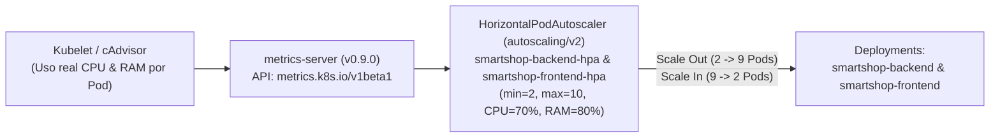

# Horizontal Pod Autoscaler (HPA v2) — Documentación Técnica

## 1. Qué es
El **Horizontal Pod Autoscaler (`autoscaling/v2`)** es el controlador nativo de elasticidad de Kubernetes que ajusta automáticamente el número de réplicas de un `Deployment` en función de métricas de uso de recursos en tiempo real recolectadas por `metrics-server`.

## 2. Para qué sirve
Sirve para absorber picos de tráfico en **SmartShop** escalando hacia afuera (**Scale Out**, de `2` hasta `10` pods) cuando la utilización de **CPU supera el 70%** o la **Memoria RAM supera el 80%**, y liberar recursos escalando hacia adentro (**Scale In**, de regreso a `2` pods) cuando la demanda disminuye.

## 3. Arquitectura

## 4. Configuración
- **Manifiesto HPA v2**: [`k8s/hpa/smartshop-hpa.yaml`](file:///c:/Users/juand/Documents/Plataformas%20II/SmartShop/smartshop-cloud-native-platform/k8s/hpa/smartshop-hpa.yaml)
- **Evidencia de Pruebas de Carga**:
  - [`docs/evidence/hpa/scale-out-snapshot.txt`](file:///c:/Users/juand/Documents/Plataformas%20II/SmartShop/smartshop-cloud-native-platform/docs/evidence/hpa/scale-out-snapshot.txt)
  - [`docs/evidence/hpa/scale-in-snapshot.txt`](file:///c:/Users/juand/Documents/Plataformas%20II/SmartShop/smartshop-cloud-native-platform/docs/evidence/hpa/scale-in-snapshot.txt)
  - [`docs/evidence/hpa/hpa-load-test-report.md`](file:///c:/Users/juand/Documents/Plataformas%20II/SmartShop/smartshop-cloud-native-platform/docs/evidence/hpa/hpa-load-test-report.md)

## 5. Parámetros usados

| Parámetro | Valor Configurado | Descripción |
| :--- | :--- | :--- |
| `minReplicas` | `2` | Mínimo de réplicas activas para garantizar alta disponibilidad (HA). |
| `maxReplicas` | `10` | Techo máximo de réplicas para proteger la capacidad del clúster. |
| `metrics[0] (cpu)` | `Utilization: 70%` | Umbral de CPU relativo a `resources.requests.cpu`. |
| `metrics[1] (memory)` | `Utilization: 80%` | Umbral de RAM relativo a `resources.requests.memory`. |
| `scaleUp.stabilizationWindowSeconds` | `0s` (`Max: 100%` o `4 Pods / 15s`) | Reacción inmediata ante picos súbitos de tráfico (*Flash Sales*). |
| `scaleDown.stabilizationWindowSeconds` | `15s` (`Max: 4 Pods / 15s`) | Retorno ágil y controlado al cesar la carga sin oscilaciones bruscas (*thrashing*). |

## 6. Beneficios
- **Elasticidad automática sin intervención humana**: Demostrado en vivo escalando de `2` a `9` réplicas ante un pico del `288%` de CPU y regresando a `2` réplicas al volver al `2%` de CPU.
- **Eficiencia financiera (FinOps)**: Evita pagar por 10 réplicas permanentes durante las horas valle.

## 7. Riesgos
- **Efecto de aleteo (*Flapping / Thrashing*)**: Si las ventanas de estabilización no están configuradas adecuadamente, el número de pods puede oscilar continuamente; se controla mediante las políticas `behavior.scaleUp` y `behavior.scaleDown`.
- **Dependencia de `resources.requests`**: Si un `Deployment` omite `resources.requests`, el HPA no puede calcular el porcentaje de utilización (`<unknown>/70%`).

## 8. Buenas prácticas
- Utilizar siempre la API `autoscaling/v2` para combinar múltiples métricas (`cpu` + `memory`) y políticas de comportamiento (`behavior`).
- Mantener `minReplicas >= 2` en todos los servicios críticos de cara al usuario para evitar puntos únicos de fallo.
