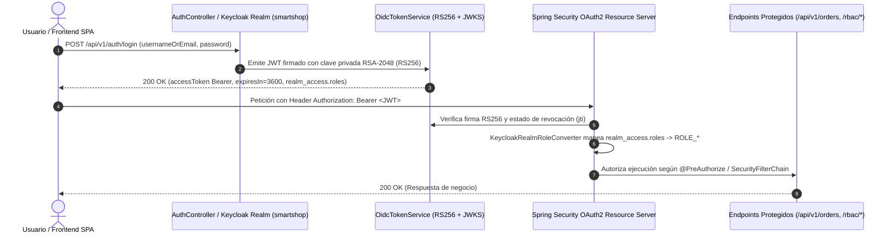

# Keycloak 26 & OAuth2 / OIDC Security — Documentación Técnica

## 1. Qué es

**Keycloak 26** es una solución empresarial de Gestión de Identidad y Acceso (_Identity and Access Management — IAM_) de código abierto que implementa los estándares **OAuth 2.0**, **OpenID Connect (OIDC 1.0)** y **JSON Web Tokens (JWT RS256)** con control de acceso basado en roles (**RBAC**).

## 2. Para qué sirve

Sirve para centralizar la autenticación (_Single Sign-On — SSO_), la emisión y revocación de tokens criptográficos firmados con RSA-2048 (`RS256`), la publicación de claves públicas mediante **JWKS (`/.well-known/jwks.json`)** y la autorización granular por roles (`ADMIN`, `MANAGER`, `CUSTOMER`) sobre los microservicios de **SmartShop**.

## 3. Arquitectura

## 4. Configuración

La implementación de identidad y seguridad está distribuida en:

- **Exportación declarativa del Realm**: [`authentication/keycloak/smartshop-realm.json`](file:///c:/Users/juand/Documents/Plataformas%20II/SmartShop/smartshop-cloud-native-platform/authentication/keycloak/smartshop-realm.json)
- **Orquestación de Keycloak 26**: [`authentication/keycloak/docker-compose.keycloak.yml`](file:///c:/Users/juand/Documents/Plataformas%20II/SmartShop/smartshop-cloud-native-platform/authentication/keycloak/docker-compose.keycloak.yml)
- **Resource Server & Filtro JWT RS256**: [`SecurityConfiguration.java`](file:///c:/Users/juand/Documents/Plataformas%20II/SmartShop/smartshop-cloud-native-platform/backend/src/main/java/com/smartshop/platform/infrastructure/config/SecurityConfiguration.java)
- **Emisor, Validador RS256 y Revocación (Logout)**: [`OidcTokenService.java`](file:///c:/Users/juand/Documents/Plataformas%20II/SmartShop/smartshop-cloud-native-platform/backend/src/main/java/com/smartshop/platform/infrastructure/config/OidcTokenService.java)
- **Mapeador de Roles OIDC (`realm_access.roles`)**: [`KeycloakRealmRoleConverter.java`](file:///c:/Users/juand/Documents/Plataformas%20II/SmartShop/smartshop-cloud-native-platform/backend/src/main/java/com/smartshop/platform/infrastructure/config/KeycloakRealmRoleConverter.java)
- **Controlador OIDC / RBAC / JWKS**: [`AuthController.java`](file:///c:/Users/juand/Documents/Plataformas%20II/SmartShop/smartshop-cloud-native-platform/backend/src/main/java/com/smartshop/platform/infrastructure/adapter/in/web/AuthController.java)

## 5. Parámetros usados

| Parámetro               | Valor Configurado                                                     | Descripción                                                                                 |
| :---------------------- | :-------------------------------------------------------------------- | :------------------------------------------------------------------------------------------ |
| `realm`                 | `smartshop`                                                           | Espacio de nombres de identidad aislado para la plataforma SmartShop.                       |
| `clients`               | `smartshop-frontend` (public PKCE), `smartshop-backend` (bearer-only) | Clientes OIDC registrados en el realm.                                                      |
| `roles.realm`           | `ADMIN`, `MANAGER`, `CUSTOMER`                                        | Jerarquía de roles empresariales mapeados a `ROLE_ADMIN`, `ROLE_MANAGER` y `ROLE_CUSTOMER`. |
| `Algorithm / Key Size`  | `RS256` (`RSA 2048-bit`, `kid: smartshop-rsa-key-1`)                  | Algoritmo asimétrico estándar para firma y verificación de tokens OIDC.                     |
| `accessTokenLifespan`   | `3600` segundos (1 hora)                                              | Tiempo de vida del token de acceso antes de requerir renovación.                            |
| `SessionCreationPolicy` | `STATELESS`                                                           | Cero estado de sesión HTTP en memoria del servidor para escalabilidad horizontal pura.      |

## 6. Beneficios

- **Seguridad Zero-Trust sin estado (_Stateless_)**: Cualquier réplica del backend escalada por HPA valida tokens JWT sin afinidad de sesión (_sticky sessions_).
- **Revocación inmediata en Logout**: `POST /api/v1/auth/logout` registra el `jti` / digest del token revocado e invalida su uso posterior inmediatamente (`401 Unauthorized`).
- **Separación estricta de privilegios (RBAC)**: Los clientes (`CUSTOMER`) no pueden crear productos ni acceder a endpoints administrativos (`403 Forbidden`).

## 7. Riesgos

- **Tokens de larga duración robados en el cliente**: Si un token tuviera expiración excesiva y fuera exfiltrado, permitiría acceso no autorizado; se mitiga con expiración de `3600s` y lista de revocación activa en `/api/v1/auth/logout`.
- **Desincronización de reloj (_Clock Skew_)**: Diferencias de NTP entre contenedores pueden invalidar claims `iat`/`exp`.

## 8. Buenas prácticas

- Firmar tokens exclusivamente con criptografía asimétrica (`RS256`) y exponer únicamente las claves públicas vía JWKS (`/.well-known/jwks.json`).
- Extraer roles desde el claim estándar de Keycloak `realm_access.roles` convirtiéndolos al prefijo `ROLE_` requerido por Spring Security.
- Mantener los endpoints de salud (`/actuator/health/**`) públicos para las sondas de Kubernetes mientras se protegen las mutaciones de catálogo, carritos y órdenes.
