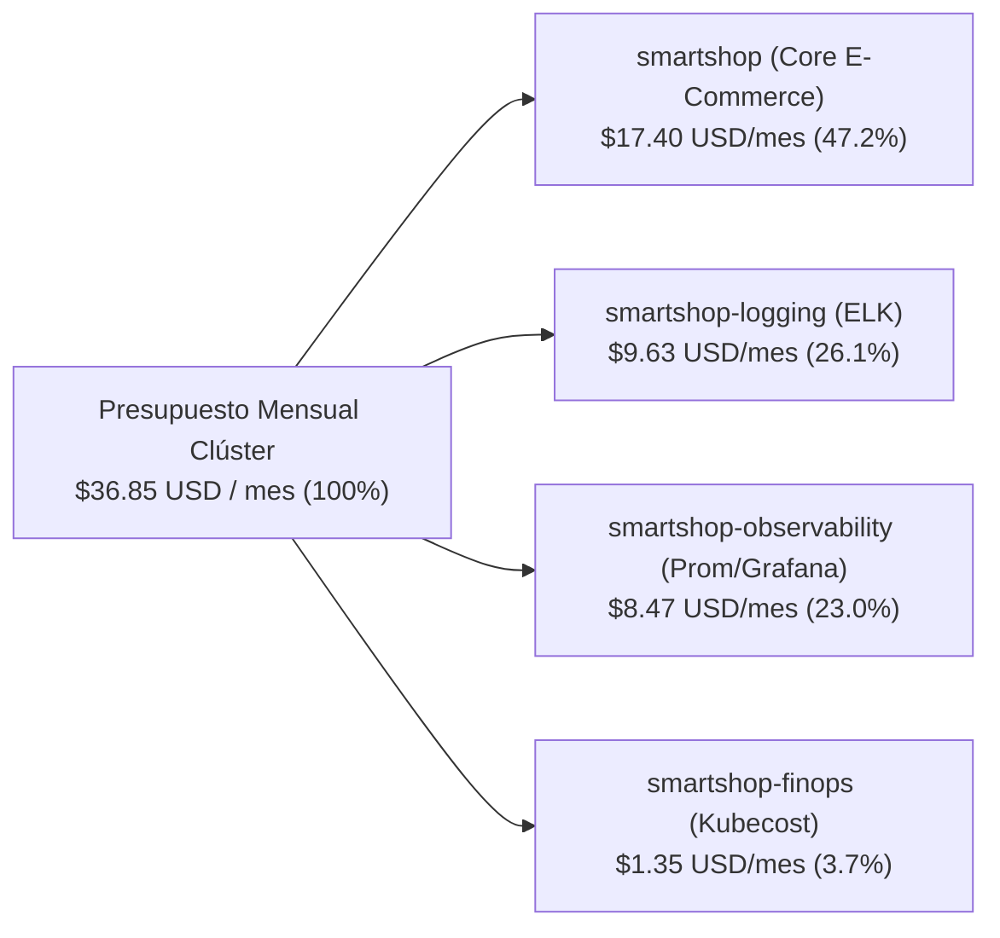

# Valor Empresarial de FinOps con Kubecost — Optimización Financiera Cloud-Native

## 1. Resumen Ejecutivo
El gasto en infraestructura Kubernetes suele crecer de manera descontrolada cuando los equipos de ingeniería sobreaprovisionan recursos (`CPU` y `RAM`) por precaución. La integración de **Kubecost (`v2.5.2`)** en el namespace `smartshop-finops` introduce disciplina **FinOps** en tiempo real, permitiendo atribuir cada dólar de infraestructura a un centro de costo (`Namespace`), servicio (`Deployment`) y carga de trabajo (`Workload`).

---

## 2. Distribución Actual de Costos y Eficiencia en SmartShop

---

## 3. Análisis Financiero por Namespace y Oportunidades de Ahorro

| Namespace / Dominio | Costo Mensual Actual (USD) | % del Total | Ahorro Mensual Identificado (USD) | Estrategia de Optimización Recomendada por Kubecost |
| :--- | :---: | :---: | :---: | :--- |
| **`smartshop` (Core E-Commerce)** | `$17.40` | `47.2%` | **`$6.86`** (`$1.02` Frontend + `$5.84` Backend) | *Right-Sizing* de `smartshop-frontend` y reducción automática fuera de horas pico mediante `HPA`. |
| **`smartshop-logging` (ELK Stack)** | `$9.63` | `26.1%` | **`$2.15`** | Compresión de lotes en `smartshop-logstash` y rotación ILM de 7 días en Elasticsearch. |
| **`smartshop-observability`** | `$8.47` | `23.0%` | `$0.00` (Óptimo) | Dimensionamiento eficiente verificado sobre Prometheus, Grafana, Alertmanager y Jaeger. |
| **`smartshop-finops` (Kubecost)** | `$1.35` | `3.7%` | `$0.00` (Óptimo) | El propio motor FinOps consume solo `3.7%` del clúster mientras genera un ahorro del **`24.4%`**. |
| **TOTAL CLÚSTER** | **`$36.85 / mes`** | **`100%`** | **`$9.01 / mes` (`24.4%` ROI)** | **Retorno neto de inversión inmediato (`6.6x` el costo de ejecutar Kubecost).** |

---

## 4. Beneficios y Justificación Empresarial
1. **ROI Positivo Inmediato (`6.6x`)**: Operar `smartshop-kubecost` cuesta `$1.35 USD/mes` y descubre `$9.01 USD/mes` en ahorros accionables inmediatos (**24.4% de reducción del gasto cloud**), un patrón que escala linealmente cuando la empresa pasa a clústeres de producción de miles de dólares mensuales.
2. **Transparencia Contable (*Showback & Chargeback*)**: Finanzas y Dirección de Tecnología pueden auditar exactamente cuánto cuesta ejecutar el motor de ventas (`smartshop`) frente a las herramientas de auditoría (`smartshop-logging`) y monitoreo (`smartshop-observability`).
3. **Prevención de Sorpresas en la Factura Cloud**: Al integrar métricas de costo en Prometheus (`kubecost_namespace_cost_monthly_usd`, `kubecost_deployment_cost_monthly_usd`), cualquier incremento inesperado por un despliegue mal configurado es detectado el mismo día y no al final del mes.
