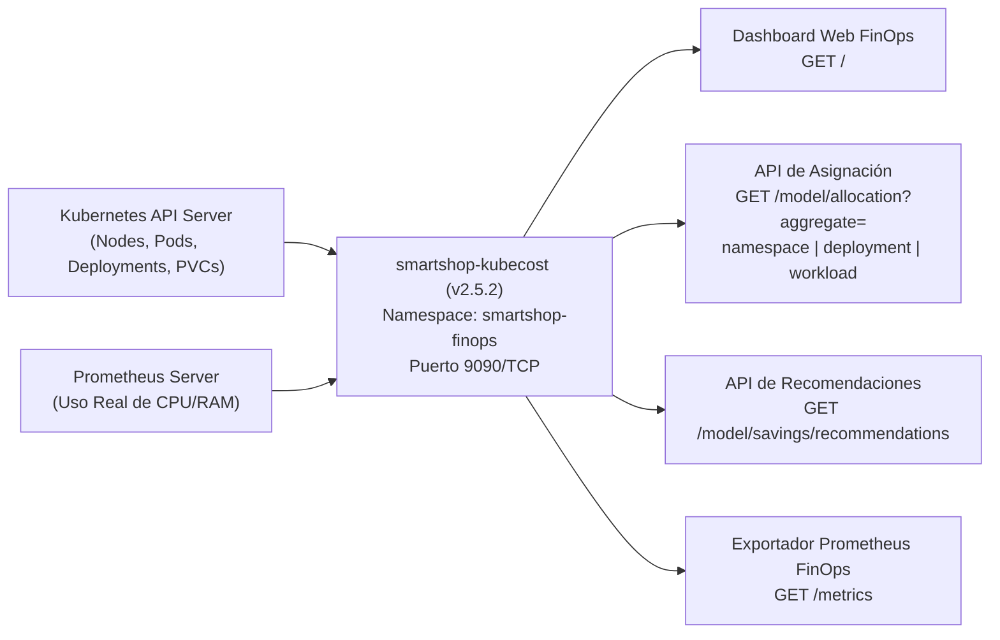

# Kubecost Cloud-Native FinOps — Documentación Técnica

## 1. Qué es

**Kubecost (`v2.5.2`)** es la plataforma de visibilidad financiera y gobierno de costos (**FinOps**) para Kubernetes desplegada en el namespace `smartshop-finops`. Permite atribuir en tiempo real el gasto de infraestructura (CPU, Memoria RAM y Almacenamiento Persistente) a cada unidad técnica y de negocio del clúster.

## 2. Para qué sirve

Sirve para:

1. **Visualizar costos por `Namespace`** (`smartshop`, `smartshop-observability`, `smartshop-logging`, `smartshop-finops`).
2. **Visualizar costos por `Deployment` y `Workload`** (`11` cargas de trabajo con cálculo de eficiencia real frente a recursos solicitados).
3. **Generar Recomendaciones de Ahorro (_Right-Sizing_ y _Autoscaling_)** accionables para eliminar el sobreaprovisionamiento (_cloud waste_).

## 3. Arquitectura

## 4. Configuración

Los manifiestos de FinOps se ubican en [`cost-management/kubecost/`](file:///c:/Users/juand/Documents/Plataformas%20II/SmartShop/smartshop-cloud-native-platform/cost-management/kubecost/):

- **RBAC, Modelo de Precios Unitarios y Motor FinOps**: [`cost-management/kubecost/kubecost-config.yaml`](file:///c:/Users/juand/Documents/Plataformas%20II/SmartShop/smartshop-cloud-native-platform/cost-management/kubecost/kubecost-config.yaml)
- **Deployment y Service (`9090/TCP`)**: [`cost-management/kubecost/kubecost-deployment.yaml`](file:///c:/Users/juand/Documents/Plataformas%20II/SmartShop/smartshop-cloud-native-platform/cost-management/kubecost/kubecost-deployment.yaml)

## 5. Parámetros usados

| Parámetro                    | Valor Configurado                                                            | Descripción                                                      |
| :--------------------------- | :--------------------------------------------------------------------------- | :--------------------------------------------------------------- |
| `cpuHourlyCostPerCore`       | `$0.031611 USD / core-hora`                                                  | Tarifa estándar CNCF/On-Demand por vCPU asignada.                |
| `ramHourlyCostPerGiB`        | `$0.004237 USD / GiB-hora`                                                   | Tarifa estándar CNCF/On-Demand por GiB de memoria RAM.           |
| `pvHourlyCostPerGiB`         | `$0.0000548 USD / GiB-hora`                                                  | Tarifa por GiB de almacenamiento en bloque (`PersistentVolume`). |
| `hoursPerMonth`              | `730 horas`                                                                  | Ventana mensual estándar para proyección de presupuesto FinOps.  |
| `PROMETHEUS_SERVER_ENDPOINT` | `http://smartshop-prometheus.smartshop-observability.svc.cluster.local:9090` | Conexión al servidor Prometheus del clúster.                     |

## 6. Beneficios

- **Transparencia financiera (_Showback / Chargeback_)**: Permite conocer con exactitud cuánto cuesta operar la tienda (`smartshop`: \$17.40/mes) frente a las plataformas de soporte (`smartshop-logging`: \$9.63/mes, `smartshop-observability`: \$8.47/mes).
- **Optimización continua basada en eficiencia**: Identifica oportunidades inmediatas de ahorro (**\$9.01 USD/mes**, equivalente a un **24.4%** del costo total del clúster) mediante ajuste de `requests` y escalamiento dinámico.

## 7. Riesgos

- **Sub-aprovisionamiento agresivo (_Under-provisioning_)**: Reducir los `requests` por debajo del percentil P95 de uso real puede inducir estrangulamiento de CPU (_CPU throttling_) o terminaciones `OOMKilled`.

## 8. Buenas prácticas

- Mantener un margen de seguridad (_headroom_) del 20–25% sobre el uso P95 al aplicar recomendaciones de _Right-Sizing_.
- Combinar las recomendaciones estáticas de Kubecost con el escalamiento dinámico del `HorizontalPodAutoscaler` (`HPA`).
