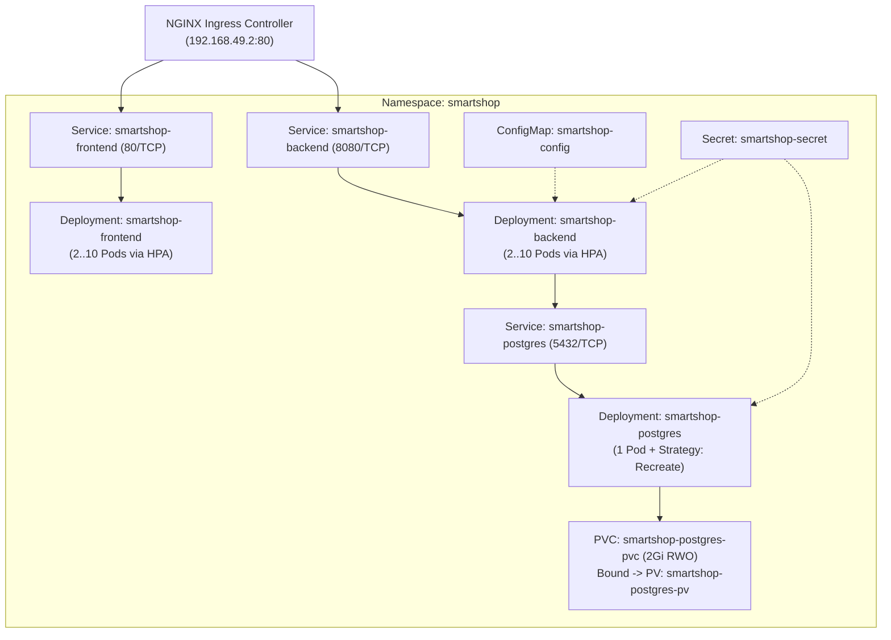

# Kubernetes (Minikube v1.39 / K8s v1.37) — Documentación Técnica

## 1. Qué es

**Kubernetes (K8s)** es la plataforma estándar de código abierto graduada por la CNCF para la orquestación declarativa de cargas de trabajo en contenedores. En **SmartShop Cloud-Native Platform**, se ejecuta sobre **Minikube v1.39.0 (`Kubernetes v1.37.0` / `containerd 2.3.4`)** proporcionando reconciliación continua de estado deseado, descubrimiento de servicios DNS (`CoreDNS`), enrutamiento L7 (`ingress-nginx`), almacenamiento persistente (`PV`/`PVC`) y micro-segmentación Zero-Trust (`NetworkPolicy`).

## 2. Para qué sirve

Sirve para automatizar el despliegue, la autorrecuperación (_self-healing_), el escalamiento horizontal (`HPA`), la gestión de configuración (`ConfigMap`/`Secret`) y el aislamiento de red entre los 5 dominios de la plataforma:

- `smartshop` (Frontend, Backend, PostgreSQL)
- `smartshop-observability` (Prometheus, Grafana, Alertmanager, Jaeger, Node Exporter, Kube-State-Metrics)
- `smartshop-logging` (Elasticsearch, Logstash, Kibana)
- `smartshop-finops` (Kubecost)
- `smartshop-rollouts` (Blue-Green, Canary, Shadow, Feature Flags)

## 3. Arquitectura

## 4. Configuración

Los manifiestos declarativos se organizan modularmente dentro de [`k8s/`](file:///c:/Users/juand/Documents/Plataformas%20II/SmartShop/smartshop-cloud-native-platform/k8s/):

- **Namespaces**: [`k8s/namespaces/smartshop-namespaces.yaml`](file:///c:/Users/juand/Documents/Plataformas%20II/SmartShop/smartshop-cloud-native-platform/k8s/namespaces/smartshop-namespaces.yaml)
- **ConfigMaps & Secrets**: [`k8s/configmaps/smartshop-configmap.yaml`](file:///c:/Users/juand/Documents/Plataformas%20II/SmartShop/smartshop-cloud-native-platform/k8s/configmaps/smartshop-configmap.yaml) y [`k8s/secrets/smartshop-secret.yaml`](file:///c:/Users/juand/Documents/Plataformas%20II/SmartShop/smartshop-cloud-native-platform/k8s/secrets/smartshop-secret.yaml)
- **Almacenamiento**: [`k8s/pvc/postgres-pv.yaml`](file:///c:/Users/juand/Documents/Plataformas%20II/SmartShop/smartshop-cloud-native-platform/k8s/pvc/postgres-pv.yaml) y [`k8s/pvc/postgres-pvc.yaml`](file:///c:/Users/juand/Documents/Plataformas%20II/SmartShop/smartshop-cloud-native-platform/k8s/pvc/postgres-pvc.yaml)
- **Deployments & Services**: [`k8s/deployments/`](file:///c:/Users/juand/Documents/Plataformas%20II/SmartShop/smartshop-cloud-native-platform/k8s/deployments/) y [`k8s/services/`](file:///c:/Users/juand/Documents/Plataformas%20II/SmartShop/smartshop-cloud-native-platform/k8s/services/)
- **Ingress & NetworkPolicies**: [`k8s/ingress/smartshop-ingress.yaml`](file:///c:/Users/juand/Documents/Plataformas%20II/SmartShop/smartshop-cloud-native-platform/k8s/ingress/smartshop-ingress.yaml) y [`k8s/network-policies/`](file:///c:/Users/juand/Documents/Plataformas%20II/SmartShop/smartshop-cloud-native-platform/k8s/network-policies/)

## 5. Parámetros usados

| Recurso / Componente | Parámetro               | Valor Configurado                     | Propósito                                                                                         |
| :------------------- | :---------------------- | :------------------------------------ | :------------------------------------------------------------------------------------------------ |
| `Minikube Cluster`   | `--cpus` / `--memory`   | `4 CPUs` / `6144 MB`                  | Capacidad base para correr los 5 namespaces concurrentemente.                                     |
| `smartshop-backend`  | `requests` / `limits`   | `200m CPU, 384Mi` / `750m CPU, 768Mi` | Garantiza QoS `Burstable` y permite cálculo exacto para HPA y Kubecost.                           |
| `smartshop-frontend` | `requests` / `limits`   | `50m CPU, 64Mi` / `250m CPU, 128Mi`   | Huella ligera para Nginx SPA con sondas `/healthz`.                                               |
| `smartshop-postgres` | `strategy.type` / `PVC` | `Recreate` / `2Gi ReadWriteOnce`      | Evita contención de bloqueo de archivos WAL sobre el volumen persistente.                         |
| `NetworkPolicy`      | `default-deny-all`      | `Ingress` + `Egress`                  | Bloqueo Zero-Trust por defecto; solo rutas explícitas (`frontend->backend->postgres`) permitidas. |

## 6. Beneficios

- **Autorrecuperación automática (_Self-Healing_)**: Reinicio inmediato de contenedores ante fallos de `livenessProbe` y exclusión automática del balanceador ante fallos de `readinessProbe`.
- **Aislamiento multi-dominio**: Separación lógica y de red entre cargas transaccionales (`smartshop`), telemetría (`smartshop-observability`, `smartshop-logging`) y FinOps (`smartshop-finops`).
- **Portabilidad Cloud-Native**: Los mismos manifiestos YAML son desplegables sin cambios en EKS, GKE, AKS o Minikube.

## 7. Riesgos

- **Bloqueo de sondas kubelet por NetworkPolicy**: Si una `NetworkPolicy` de tipo `Ingress` restringe únicamente por `podSelector`, las sondas HTTP `readinessProbe`/`livenessProbe` originadas desde la IP del nodo pueden ser descartadas; se mitigó añadiendo `ipBlock` para la red de administración del nodo (`10.244.0.1/32` y `192.168.49.0/24`).
- **Agotamiento de recursos (_OOMKilled_)**: Cargas Java/JVM sin límites explícitos pueden consumir toda la RAM del nodo; se mitigó mediante `-XX:+UseContainerSupport -XX:MaxRAMPercentage=75.0`.

## 8. Buenas prácticas

- Definir siempre `resources.requests` y `resources.limits` en todos los contenedores.
- Separar `readinessProbe` (`/actuator/health/readiness`) de `livenessProbe` (`/actuator/health/liveness`) para evitar reinicios en cascada cuando la base de datos experimenta latencia transitoria.
- Utilizar `imagePullPolicy: IfNotPresent` con etiquetas de versión semántica (`1.0.0`, nunca `:latest`).
