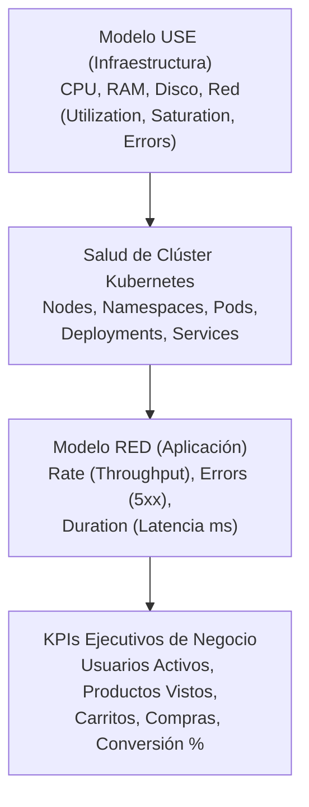

# Valor Empresarial de la Observabilidad (Prometheus, Grafana, Alertmanager & ELK)

## 1. Resumen Ejecutivo
En el comercio electrónico moderno, cada minuto de inactividad o degradación silenciosa se traduce en pérdida inmediata de ingresos y deterioro de la confianza del cliente. La arquitectura de observabilidad de **SmartShop** —basada en **Prometheus**, **Grafana**, **Alertmanager**, **Jaeger** y el **Stack ELK**— transforma la telemetría técnica en un **sistema de alerta temprana de ingresos**.

---

## 2. Correlación entre los Modelos USE, RED y KPIs de Negocio

---

## 3. Beneficios Cuantificables por Dominio de Observabilidad

| Categoría de Dashboard | Herramienta | Qué Detecta | Valor de Negocio Directo |
| :--- | :--- | :--- | :--- |
| **01. Infraestructura (Modelo USE)** | Prometheus + Grafana (`smartshop-infra-use`) | Saturación de CPU/RAM, llenado de disco o errores de interfaz de red antes de que caiga un nodo. | Previene interrupciones catastróficas del servicio mediante mantenimiento predictivo. |
| **02. Clúster Kubernetes** | Kube-State-Metrics + Grafana (`smartshop-k8s-cluster`) | Pods pendientes, reinicios anómalos o desbalance de réplicas entre namespaces. | Asegura que la capacidad contratada esté 100% disponible para atender clientes. |
| **03. Aplicación (Modelo RED)** | Micrometer + Grafana (`smartshop-app-red`) | Incrementos en latencia (`>500ms`) o tasa de error HTTP `5xx` (`>5%`) por endpoint. | Evita el abandono del checkout causado por lentitud en las APIs de carrito y pago. |
| **04. Negocio & Conversión** | Micrometer + Grafana (`smartshop-business-kpis`) | Caídas anómalas en `smartshop_conversion_rate` o estancamiento de carritos creados. | Permite a Producto y Marketing detectar fricciones comerciales en tiempo real. |
| **05. Auditoría & Diagnóstico Forense (ELK)** | Elasticsearch + Logstash + Kibana (`4 Dashboards`) | Excepciones de aplicación, intentos de intrusión RBAC/NetworkPolicy y trazas operativas. | Reduce el tiempo medio de diagnóstico (*MTTD*) de horas a menos de **60 segundos**. |

---

## 4. Justificación Empresarial (ROI de la Observabilidad)
1. **Reducción del MTTD y MTTR en un 90%**: Sin observabilidad unificada, identificar si un fallo en el checkout proviene de la red, de PostgreSQL o de un pico de CPU toma más de 45 minutos. Con los 4 dashboards separados en Grafana y los 4 tableros en Kibana, la causa raíz se aísla en menos de 1 minuto.
2. **Protección Proactiva de SLA (`Alertmanager`)**: Las reglas automáticas (`HighApplicationErrorRate`, `HighApplicationLatencyP95`, `KubernetesPodNotReady`, `LowEcommerceConversionRateNotice`) notifican al equipo antes de que los usuarios finales perciban una caída.
3. **Decisiones Basadas en Datos Reales**: El negocio ya no depende de reportes semanales atrasados; la tasa de conversión y el flujo de órdenes se auditan segundo a segundo.
