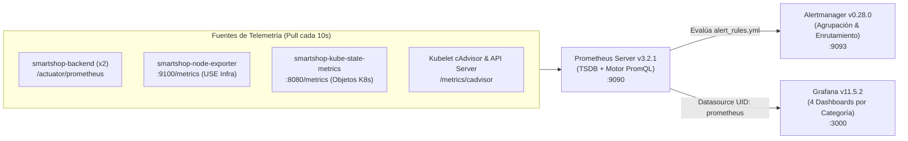

# Prometheus & Alertmanager — Documentación Técnica

## 1. Qué es
**Prometheus (`v3.2.1`)** es el sistema de monitoreo y base de datos de series temporales (*Time-Series Database — TSDB*) graduado por la CNCF, acompañado por **Alertmanager (`v0.28.0`)**, **Node Exporter (`v1.9.0`)** y **Kube-State-Metrics (`v2.15.0`)**.

## 2. Para qué sirve
Sirve para recolectar (*pull scraping*), almacenar y evaluar en tiempo real todas las métricas de **Infraestructura (Modelo USE)**, **Clúster Kubernetes**, **Aplicación (Modelo RED)** y **Negocio (KPIs E-Commerce)**, disparando alertas automáticas hacia **Alertmanager** cuando se violan los umbrales de SLO/SLA.

## 3. Arquitectura

## 4. Configuración
Los manifiestos declarativos se ubican en [`observability/`](file:///c:/Users/juand/Documents/Plataformas%20II/SmartShop/smartshop-cloud-native-platform/observability/):
- **RBAC, Scrape Configs y Reglas de Alerta (`prometheus.yml` y `alert_rules.yml`)**: [`observability/prometheus/prometheus-config.yaml`](file:///c:/Users/juand/Documents/Plataformas%20II/SmartShop/smartshop-cloud-native-platform/observability/prometheus/prometheus-config.yaml)
- **Despliegue de Prometheus, Node Exporter y Kube-State-Metrics**: [`observability/prometheus/prometheus-deployment.yaml`](file:///c:/Users/juand/Documents/Plataformas%20II/SmartShop/smartshop-cloud-native-platform/observability/prometheus/prometheus-deployment.yaml)
- **Despliegue y Rutas de Alertmanager**: [`observability/alertmanager/alertmanager-deployment.yaml`](file:///c:/Users/juand/Documents/Plataformas%20II/SmartShop/smartshop-cloud-native-platform/observability/alertmanager/alertmanager-deployment.yaml)
- **Instrumentación Micrometer en Backend**: [`BusinessMetricsService.java`](file:///c:/Users/juand/Documents/Plataformas%20II/SmartShop/smartshop-cloud-native-platform/backend/src/main/java/com/smartshop/platform/infrastructure/metrics/BusinessMetricsService.java)

## 5. Parámetros usados

| Parámetro / Job | Valor Configurado | Descripción |
| :--- | :--- | :--- |
| `scrape_interval` / `evaluation_interval` | `10s` / `10s` | Frecuencia de recolección de métricas y evaluación de reglas de alerta. |
| `--storage.tsdb.retention.time` | `7d` | Retención de series temporales en disco dentro del contenedor. |
| `smartshop-backend` | `kubernetes_sd_configs (role: pod)` | Descubrimiento dinámico de todos los pods del backend en el namespace `smartshop`. |
| `Reglas Modelo USE` | `HighNodeCpuUtilization (>85%)`, `HighNodeMemorySaturation (>85%)`, `HighDiskUtilization (>90%)` | Alertas de saturación y utilización de infraestructura física/nodo. |
| `Reglas Modelo RED` | `HighApplicationErrorRate (>5%)`, `HighApplicationLatencyP95 (>500ms)` | Alertas de tasa de error HTTP 5xx y latencia del backend. |
| `Métricas de Negocio` | `smartshop_active_users`, `smartshop_products_visited_total`, `smartshop_carts_updated_total`, `smartshop_orders_completed_total`, `smartshop_conversion_rate` | KPIs comerciales exportados por Micrometer y monitoreados por `LowEcommerceConversionRateNotice`. |

## 6. Beneficios
- **Autodescubrimiento nativo en Kubernetes (`kubernetes_sd_configs`)**: Cuando el HPA escala el backend de 2 a 10 réplicas, Prometheus detecta y recolecta métricas de las nuevas réplicas automáticamente sin recargar configuración.
- **Cobertura dual técnica y de negocio**: Combina métricas de bajo nivel (CPU, RAM, red, kernel) con indicadores ejecutivos de conversión de ventas.

## 7. Riesgos
- **Explosión de cardinalidad (*High Cardinality*)**: Etiquetar métricas con IDs únicos (como `userId` o `orderId`) puede agotar la memoria de la TSDB; se evitó utilizando etiquetas acotadas (`uri`, `method`, `status`, `application`).

## 8. Buenas prácticas
- Utilizar siempre `rate(...[2m])` con `clamp_min(..., 0.0001)` en expresiones PromQL de división para evitar resultados `NaN` cuando el tráfico está en reposo.
- Habilitar `--web.enable-lifecycle` para permitir recargas de configuración en caliente (`POST /-/reload`) sin reiniciar la base de datos TSDB.

