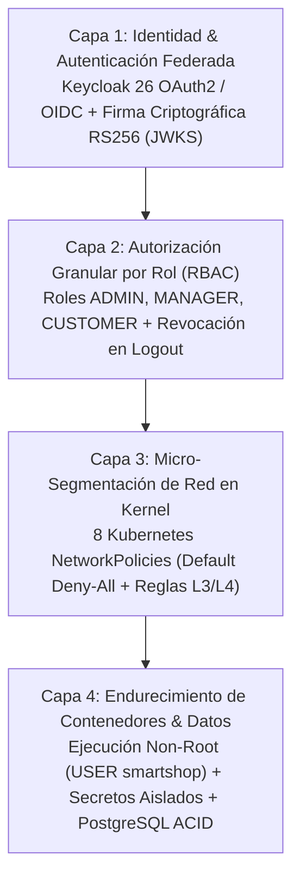

# Valor Empresarial de la Seguridad Zero-Trust (Keycloak OIDC, RBAC & NetworkPolicies)

## 1. Resumen Ejecutivo

Las brechas de seguridad en plataformas de comercio electrónico generan costos multimillonarios por sanciones regulatorias, fraude transaccional y pérdida irreversible de clientes. **SmartShop Cloud-Native Platform** implementa una arquitectura de **Defensa en Profundidad y Zero-Trust** desde la capa de identidad (**Keycloak 26 OAuth2/OIDC + RS256 JWT + RBAC**) hasta el aislamiento de paquetes en el kernel de Kubernetes (**NetworkPolicies L3/L4** y contenedores sin privilegios root).

---

## 2. Arquitectura de Defensa en Profundidad (4 Capas)

---

## 3. Matriz de Controles de Seguridad y Mitigación de Riesgos de Negocio

| Control Implementado                                        | Amenaza que Neutraliza                                                       | Evidencia Verificada en la Plataforma                                                                    | Valor de Negocio y Cumplimiento                                                         |
| :---------------------------------------------------------- | :--------------------------------------------------------------------------- | :------------------------------------------------------------------------------------------------------- | :-------------------------------------------------------------------------------------- |
| **OAuth2 / OIDC con JWT RS256 (`OidcTokenService`)**        | Falsificación de sesiones y suplantación de identidad.                       | Firma RSA-2048 verificada contra `/.well-known/jwks.json`.                                               | Protege las cuentas de clientes y administradores bajo estándares bancarios.            |
| **Revocación Inmediata en Logout (`/api/v1/auth/logout`)**  | Reutilización de tokens robados tras cerrar sesión.                          | Uso de token post-logout rechazado con `401 Unauthorized`.                                               | Cumple con requisitos de cierre de sesión seguro de OWASP ASVS y PCI-DSS.               |
| **Control de Acceso Basado en Roles (`RBAC`)**              | Escalación de privilegios por usuarios no autorizados.                       | Rol `CUSTOMER` bloqueado con `403 Forbidden` en `/rbac/admin` y creación de catálogo.                    | Garantiza segregación de funciones (_Segregation of Duties — SoD_) en auditorías SOC 2. |
| **Micro-Segmentación `NetworkPolicy` (`default-deny-all`)** | Movimiento lateral hacia la base de datos si el frontend fuera comprometido. | Conexión directa `smartshop-frontend -> smartshop-postgres:5432` bloqueada en kernel (`verdict="drop"`). | Blindaje total de los datos financieros y de clientes en PostgreSQL 17.                 |
| **Contenedores Non-Root (`USER smartshop`)**                | Escape de contenedor hacia el nodo anfitrión.                                | `backend/Dockerfile` ejecuta la JVM bajo usuario sin privilegios `smartshop`.                            | Reduce drásticamente la superficie de ataque en el runtime de contenedores.             |

---

## 4. Justificación Empresarial

1. **Eliminación del Movimiento Lateral**: En arquitecturas tradicionales, un atacante que explota una vulnerabilidad en la capa web tiene acceso de red directo a la base de datos. En **SmartShop**, la política `postgres-ingress-policy` y `frontend-egress-policy` descartan a nivel de kernel (`nfqueue`) cualquier paquete de `smartshop-frontend` dirigido al puerto `5432` de PostgreSQL.
2. **Aceleración de Certificaciones de Cumplimiento (PCI-DSS / ISO 27001 / SOC 2)**: Todos los eventos de seguridad se auditan en tiempo real en el dashboard **`SmartShop ELK — 02 Seguridad, OIDC, RBAC & NetworkPolicies`** de Kibana (`314+` eventos de seguridad indexados), reduciendo en semanas el costo de las auditorías externas.
